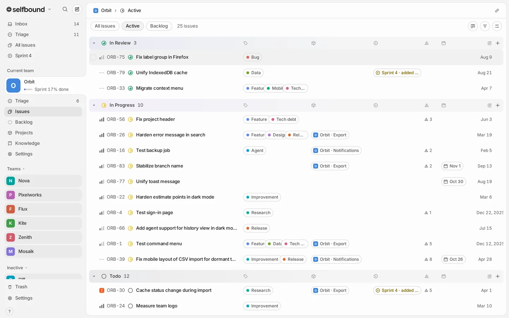
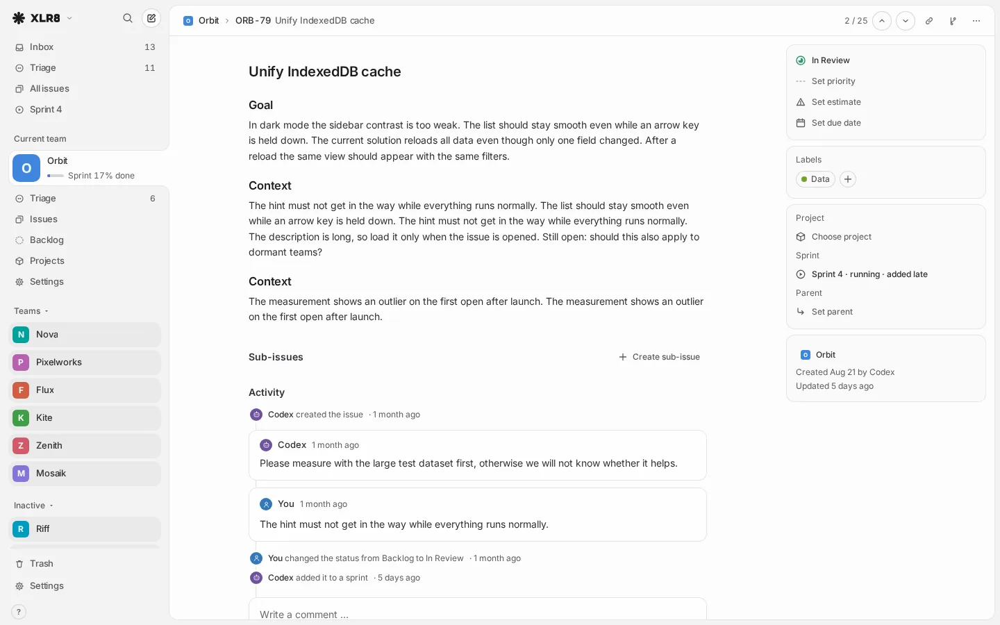
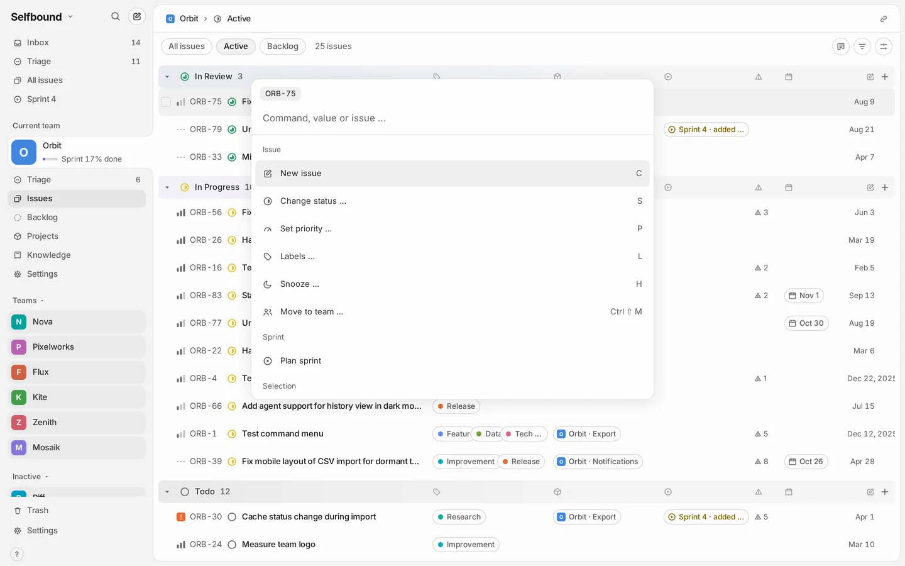

<h1 align="center">
  <picture>
    <source media="(prefers-color-scheme: dark)" srcset="app/public/brand/selfbound-lockup-paper.svg">
    
  </picture>
</h1>

<p align="center">
  <picture>
    <source media="(prefers-color-scheme: dark)" srcset="docs/images/list-dark.webp">
    
  </picture>
</p>

Selfbound is a fast, keyboard-first issue tracker built for solo developers and their AI agents. One person, no
assignees, no permissions to configure. It keeps issues, projects, sprints and a knowledge base in one
place, answers within a frame, and is open to AI agents through MCP.

> **Status: early, not announced.** Selfbound runs in daily use for one person. Expect rough edges, breaking
> changes and missing docs. Issues are welcome; code contributions are issue-first, see
> [CONTRIBUTING.md](CONTRIBUTING.md).

<table>
  <tr>
    <td width="50%">
      <picture>
        <source media="(prefers-color-scheme: dark)" srcset="docs/images/detail-dark.webp">
        
      </picture>
      <sub>Issue detail: description, properties, activity</sub>
    </td>
    <td width="50%">
      <picture>
        <source media="(prefers-color-scheme: dark)" srcset="docs/images/command-dark.webp">
        
      </picture>
      <sub>Command menu (Ctrl K)</sub>
    </td>
  </tr>
</table>

The screenshots show the sample data of `pnpm dev`, in the light or dark theme of your GitHub settings.

**Teams are areas, not people.** As in Linear, a team in Selfbound is a workspace for one area of work (a
product, a client, a private project) with its own key such as `ORB-12`, statuses, labels and
knowledge pages. Selfbound has one user; its teams are never groups of people. Why it is built this way:
[docs/decisions.md](docs/decisions.md).

## What it does

- Issues with statuses per team, priorities, labels, projects, estimates, due dates, sub-issues and relations
- One sprint that spans all teams (one person, one week, one capacity), with planning and closing
- List and board views, command menu (Ctrl K), search (/) and shortcuts for nearly everything
- Knowledge pages per team, linked with issues
- GitHub pull requests on the issue, live via webhooks
- MCP endpoint and OAuth connector for Claude, ChatGPT and coding agents
- Installable web app with push notifications
- Themes (VS Code themes or your own), English and German UI
- Import from Linear

The interface keeps all data of a workspace in memory and renders from there; the performance budget is
100 ms p95 for interactions at 10,000 issues, checked in CI (`perf/README.md`).

## Stack

Svelte 5 SPA (`app/`), a framework-neutral core with data layer, views, keyboard and undo (`core/`), and a
[Convex](https://convex.dev) backend (`backend/`). Sign-in through [Clerk](https://clerk.com). TypeScript 7.

| Folder | Content |
|---|---|
| `app/` | user interface (Svelte 5, Vite) |
| `core/` | data layer, views, keyboard, undo, search, routes, i18n |
| `backend/` | Convex schema and functions, MCP endpoint, OAuth, GitHub webhook, import, test data |
| `e2e/` | browser tests (Playwright) |
| `perf/` | performance regression harness with budget |
| `tooling/` | local start, local sign-in, Linear import, backup, deploy |
| `docs/` | architecture, design decisions, operations, self-hosting |

## Try it locally

Requires Node 24 and pnpm 11. No accounts needed: `pnpm dev` starts a local Convex backend, seeds sample
data and serves the app.

```sh
pnpm install
pnpm dev          # http://127.0.0.1:5412/
```

| Command | Effect |
|---|---|
| `pnpm dev` | local Convex (no account) + sample data + app on http://127.0.0.1:5412/ |
| `pnpm typecheck` | TypeScript and `svelte-check` |
| `pnpm test` | unit tests (Vitest) for backend, core and app |
| `pnpm e2e` | browser tests against their own local backend |
| `pnpm perf` | full performance run (needs an idle machine, see `perf/README.md`) |

## Self-hosting

Each instance belongs to one owner and uses its own Convex project, Clerk application and static host.
See [docs/self-hosting.md](docs/self-hosting.md) and [docs/operations.md](docs/operations.md).

## Contributing and security

See [CONTRIBUTING.md](CONTRIBUTING.md). Please report vulnerabilities privately as described in
[SECURITY.md](SECURITY.md).

## License

[GNU Affero General Public License v3.0](LICENSE). If you run a modified version as a service for
others, you must offer them its source code.

Copyright © 2026 Steven Hernandez and contributors.
