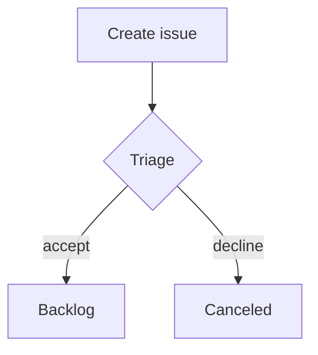

import { Aside } from '@astrojs/starlight/components';
import Kbd from '../../../components/Kbd.astro';

Besides text, lists, tables and code, descriptions, comments and knowledge pages can show **info panels**:
a tinted box with a symbol, a bold title and any content inside, and **diagrams** written in Mermaid. They are plain Markdown, so what you
build in the editor is what agents read and write through MCP, and a text that leaves Selfbound still reads
as a quote.

## Info panels

A panel is a quote whose first line is a marker in square brackets with an exclamation mark, followed by an
optional title. The content goes on the following quote lines.

```md
> [!WARNING] Post-conditions
> - Record any post-conditions
> - The second one
```

There are five kinds:

| Marker | Look | Use for |
|---|---|---|
| `[!INFO]` | blue, "i" | background and neutral information |
| `[!NOTE]` | purple, document | something to keep in mind, pre-conditions |
| `[!SUCCESS]` | green, check mark | requirements met, a result that worked |
| `[!WARNING]` | yellow, triangle | something to watch out for |
| `[!ERROR]` | red, cross | what went wrong, a failing flow |

Without a title the panel shows the name of its kind (Info, Note, Success, Warning, Error). The marker
is not case sensitive.

The panel can hold anything a text can: paragraphs, lists, checklists (you can tick them in the shown text),
code blocks, tables, images and other panels.

### GitHub alerts

The five alert names of GitHub work as well and read as the nearest kind. The name stays in the text as you
wrote it.

| GitHub | Shown as |
|---|---|
| `[!NOTE]` | Note |
| `[!WARNING]` | Warning |
| `[!TIP]` | Success |
| `[!IMPORTANT]` | Info |
| `[!CAUTION]` | Error |

A quote with another word in the brackets (`[!FOO]`) or a marker that is not on the first line stays an
ordinary quote.

<Aside type="note">
The title after the marker is a convenience of Selfbound (Obsidian reads it the same way). GitHub does not
know it and shows such a quote with the marker as text; the content stays readable.
</Aside>

## In the editor

- **/ menu:** type <Kbd keys="/" /> and "panel", "info", "warning" and so on, then pick **Panel: Warning**. On an empty
  line you get an empty panel with the cursor in the title; on a line with text, the text becomes the content.
- **While typing:** after a quote (`>` and a space), type `[!info]` and a space.
- **Title and content:** type the title, press <Kbd keys="enter" /> (or <Kbd keys="shift+enter" />) to continue in the content. Without a title the
  name of the kind is shown as a hint.
- **Change the kind:** click the symbol and choose another kind, or press <Kbd keys="mod+alt+p" /> to step
  through the kinds. The symbol's menu can also turn the panel into a quote or into plain text.
- **Back to text:** <Kbd keys="backspace" /> at the start of the title takes the panel apart and keeps its content.

## Diagrams

A fenced code block with the language `mermaid` is drawn as a diagram, in the colours of the theme you picked,
light or dark.

````md

````

These Mermaid diagram types are drawn: **flowchart** (`flowchart` or `graph`), **state** (`stateDiagram-v2`),
**sequence** (`sequenceDiagram`), **class** (`classDiagram`), **entity-relationship** (`erDiagram`) and **XY
chart** (`xychart-beta`). Other Mermaid types (pie, gantt, journey, mindmap, timeline, git graph …) are not drawn
yet: the text stays visible as code with a short note.

- The diagram loads only when it comes into view, so texts without diagrams are as fast as before.
- If the text is not a valid diagram, you see the source and the reason instead of a broken picture.
- A diagram is a picture with a text alternative for screen readers; the code behind it stays in the text, and
  the copy button copies it.
- Diagrams are limited to 20,000 characters. Links and click actions in a diagram are ignored.

In the editor, type <Kbd keys="/" /> and "diagram" and pick **Diagram (Mermaid)**, or start a code block with
` ```mermaid `. The drawing appears below the code and follows what you type; while the text is incomplete the
last good drawing stays and a note says what is wrong.

Diagrams work inside info panels too.

## Agents

Agents need no extra tool. They write the Markdown above (a `[!INFO]` quote or a `mermaid` code block) in a description, a comment or a knowledge page,
and the server instructions at connect time mention the syntax. See [Working with agents](/agents/overview/).

## Colours and themes

The panels use one hue per kind on top of the surface they sit on, so they follow the theme you picked,
light or dark, and keep their text readable in every built-in theme.
