# Polish audit: UI and workflow (SELF-116)

Date: 2026-11-10. Scope: every area of the app, used the way a daily user would, on local sample data.
The goal is a smoother, cleaner UI and workings that get less in the way. Concept, page structure, data
model, routes, stored names and MCP tools stay as they are. This is a list of concrete points to polish,
not a redesign.

## How it was done

- `pnpm dev` with the small sample set plus the roadmap demo team (`node e2e/tools/roadmap-demo.mjs`).
  No screenshot shows data from a real instance.
- Seven passes, one per area: lists and board, issue page and create dialog, menus and keyboard, inbox
  to sidebar, knowledge to settings, phone and window widths, shared styles and texts. Each pass drove
  the app with Playwright (keyboard first, then mouse), measured boxes, colours and timings, and traced
  every point to the code.
- Sizes: 1280 to 2560 px wide, phone 390×844 and 360×740, dark and light, English and German.
- Screenshots are 2x crops in [`2026-11-polish-audit/`](2026-11-polish-audit/). Headless Chromium at 1x
  drops some word spaces, so 1x shots were not used.
- Contrast numbers are WCAG ratios of the rendered colours. Text that carries information should reach
  4.5 : 1, icons and large text 3 : 1.

Each finding has an impact (how often the owner hits it times how much it hurts), an effort (S up to an
hour, M half a day, L more) and a kind (visual, text, friction). **Decision** marks a fix that changes how
the app is operated: a function moves or goes, a shortcut is new or changes, a default flow changes.
Those wait for the owner. Everything else is only smoother.

## The twenty that matter most

| # | Finding | Impact | Effort |
|---|---|---|---|
| 1 | [D1](#d1-a-clicked-button-keeps-the-focus-then-enter-and-space-go-to-it) A clicked header button keeps the focus, then Enter reopens it instead of the issue | high | S |
| 2 | [D2](#d2-the-context-menu-is-taller-than-a-laptop-window-and-cannot-scroll) Context menu is 863 px tall and cannot scroll; "Delete" is unreachable at 720 px | high | S |
| 3 | [A2](#a2-the-focused-row-is-almost-invisible-in-dark-mode) The focused row is 1.05 : 1 against the panel in dark | high | S |
| 4 | [B1](#b1-date-column-year-cut-off-two-date-columns-overlap-german-dates-ragged) Date column cuts the year and is ragged in German | high | S |
| 5 | [E1](#e1-inbox-rows-give-the-title-half-of-the-row) Inbox titles are cut after about 23 characters | high | S |
| 6 | [C2](#c2-the-properties-column-shows-the-same-kind-of-field-in-two-layouts) Properties column: two layouts, four verbs for empty fields | high | S |
| 7 | [D3](#d3-german-shows-backspace-as-entf-the-delete-key) German names Backspace "Entf", the Delete key | high | S |
| 8 | [E3](#e3-after-triage-the-toast-says-no-longer-in-this-view-instead-of-what-happened) Triage toast says "no longer in this view" instead of "accepted" | high | S |
| 9 | [A1](#a1-disabled-buttons-and-form-inputs-are-only-styled-after-settings-or-a-sprint-page-has-loaded) Disabled buttons and inputs unstyled until Settings was opened once | high | S |
| 10 | [G2](#g2-settings-on-a-phone-rows-with-a-control-do-not-wrap) Settings on a phone: text column one word per line | high | S |
| 11 | [G3](#g3-issue-page-between-769-and-about-1000-px-the-text-column-is-137-to-268-px-wide) Issue page at 769 to 1000 px: text column 137 px wide | high | S |
| 12 | [G1](#g1-sprint-close-on-a-phone-the-submit-button-lies-under-the-bottom-bar) Sprint close on a phone: submit button under the bottom bar | high | S |
| 13 | [F1](#f1-roadmap-cards-render-twice) Roadmap cards paint twice, layout shift 0.25 | high | S |
| 14 | [C1](#c1-the-create-dialog-has-three-exits-two-of-them-identical) Create dialog: three exits, two identical (Decision) | high | S |
| 15 | [C3](#c3-esc-saves-in-the-description-but-throws-the-text-away-when-editing-a-comment) Esc discards an edited comment without a word (Decision) | high | S |
| 16 | [C4](#c4-writing-a-comment-needs-the-mouse-or-about-40-tab-presses) No key for writing a comment (Decision) | high | S |
| 17 | [E2](#e2-the-inbox-opens-with-the-right-side-empty-and-the-first-j-skips-the-first-entry) Inbox opens empty on the right and the first J skips an entry (Decision) | high | S |
| 18 | [B2](#b2-display-options-cannot-be-used-with-the-keyboard) Display options need the mouse | high | S |
| 19 | [A3](#a3-light-theme-status-icons-fall-below-3--1) Light theme: "In Progress" icon at 1.7 : 1 | medium | S |
| 20 | [D4](#d4-search-says-no-results-while-the-full-text-search-is-still-running) Search shows "No results" for half a second before the hits arrive | medium | S |

## Questions for the owner

These fixes change how the app is operated and are not built without a yes. The owner gets them as one
round of questions once the first safe PRs are up. The answers go into SELF-116.

| Topic | Findings |
|---|---|
| Buttons and entries that would go or move | C1 "Save as draft", C10 empty "Sub-issues" section, C18 the "…" menu on the issue page, D19 context menu submenus, B6 limit text only when reached, F14 knowledge trash button, F18 one way to create a team |
| New or changed shortcuts | C4 R for a comment, D14 Shift F clears filters, F4 Esc leaves the settings, D12 Alt keys in the create dialog, F5 arrow keys in the knowledge tree |
| What a key does by default | C3 Esc in a comment edit, E2 first J in the inbox, D23 Enter right after opening a picker, D14 Enter on a typed filter value, F8 Enter in a new page title, F17 Enter in confirmations, D13 confirmation before every move |
| New transient UI | D11 hint while a two-key sequence waits, E19 key row in triage, B19 sticky group header, B2 focus inside display options |
| Other | E6 no triage keys on non-triage inbox entries, D22 picker position on the issue page, B17 triage issues on the board, B18 status icon on board cards, F9 one colour mapping for roadmap stages |

## Planned pull requests

| PR | Theme | Findings |
|---|---|---|
| 1 | Shared styles: states, contrast, motion | A1 to A13 |
| 2 | List rows, group headers, view bar | B1, B3 to B16, B20 |
| 3 | Menus, pickers, help, key names | D1 to D10, D15 to D21, D24 to D28 |
| 4 | Issue page, peek, create dialog | C2, C5 to C9, C11 to C17, C19 to C23 |
| 5 | Inbox, triage, sprint, pull requests, sidebar | E1, E3 to E5, E7 to E18 |
| 6 | Phone and narrow windows | G1 to G21 |
| 7 | Knowledge, roadmap, settings, missing pages | F1 to F3, F10 to F13, F15, F16, F19 to F24 |
| 8 | Texts in English and German | H1 to H8 |
| 9 | Approved changes to operation | what the owner says yes to |

Every PR that touches list rows, the store, startup, the start bundle, the keyboard or the sidebar gets the
label `tempo`. The start bundle is 137.3 kB brotli on main (`node tooling/bundle-size.mjs`) and must not
grow, so rules added to `app.css` are paid for by moving rules that only lazy pages use out of it.

## Pull requests and the owner's answers

State on 2026-11-10, in the evening. The plan above was written before the work; this is what came of it.
Not every finding of a theme is in its pull request, each PR text lists what it fixes and what it leaves.

| PR | Theme | Base |
|---|---|---|
| #68 | Shared styles: states, contrast, motion (A) | main |
| #69 | List rows, group headers, view bar (B) | main |
| #70 | Menus, pickers, help, key names (D) | #68 |
| #71 | Issue page, peek, create dialog (C) | main |
| #72 | Phone and narrow windows (G) | main |
| #73 | Inbox, triage, sprint, sidebar (E) | #70 |
| #74 | Knowledge, roadmap, settings (F) | main |
| #75 | Texts in English and German (H) | main |
| #76 | Approved: arrow keys in the knowledge tree (F5), Enter in a new page title (F8) | main |
| #77 | Approved: Esc saves a comment edit (C3), no "Save as draft" (C1), no empty "Sub-issues" section (C10) | #71 |
| #78 | Approved: R for a comment (C4), Shift F clears filters (D14), Esc leaves the settings (F4), picker starts on a real value (D23), first J in the inbox (E2), hint for two-key sequences (D11), key row in triage (E19) | #73 |
| #79 | Approved: context menu submenus (D19), limit text only when reached (B6) | #78 |

Merge order: #68, #70, #73, #78, #79 as one stack and #71, #77 as another. #69, #72, #74, #75 and #76
stand alone. The stacks exist because their PRs touch the same files and share the room in the start bundle.

The owner said yes to the fourteen changes in #76 to #79 and no to two: the picker opening at the property
on the issue page (D22) and a width limit for list rows in wide windows (B20).

Not asked, because one round has room for four questions, and therefore not built: E6, D12, D13, D14
(Enter on a typed filter value), B2, B17, B18, B19, C18, F9, F14, F17 and F18.

---

## A. Shared styles

### A1: Disabled buttons and form inputs are only styled after Settings or a sprint page has loaded
Impact high · effort S · visual

- **Where:** `app/src/styles/forms.css:2-42` holds `.input` and `.btn:disabled`. Only `settings.css`,
  `sprint.css` and `OAuthConsent.svelte` import it. The classes are also used in `Activity.svelte:190`
  ("Comment"), `NewTeamDialog.svelte`, `IssuePublic.svelte`, `ListPage.svelte:62`, `PullRequestView.svelte`,
  `ExportDialog.svelte`, `ArticleSources.svelte` and `ArticleProps.svelte`.
- **Problem:** with a running sprint the sprint header preloads and brings `forms.css` along. Without one
  nothing loads it. Then the disabled "Comment" button looks like the enabled primary button, the "Add
  team" dialog shows browser-default inputs, and "Create team" looks enabled with an empty name. The look
  changes within a session once Settings has been opened. `.icon-btn:disabled` has no rule anywhere.
- **Fix:** move `.btn:disabled` into `app.css` next to `.btn` and add
  `.icon-btn:disabled { opacity: 0.45; pointer-events: none; }`. Import `forms.css` from the lazy
  components that use `.input`.

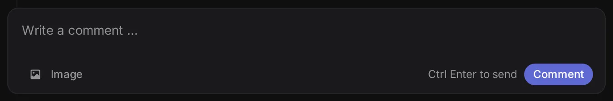
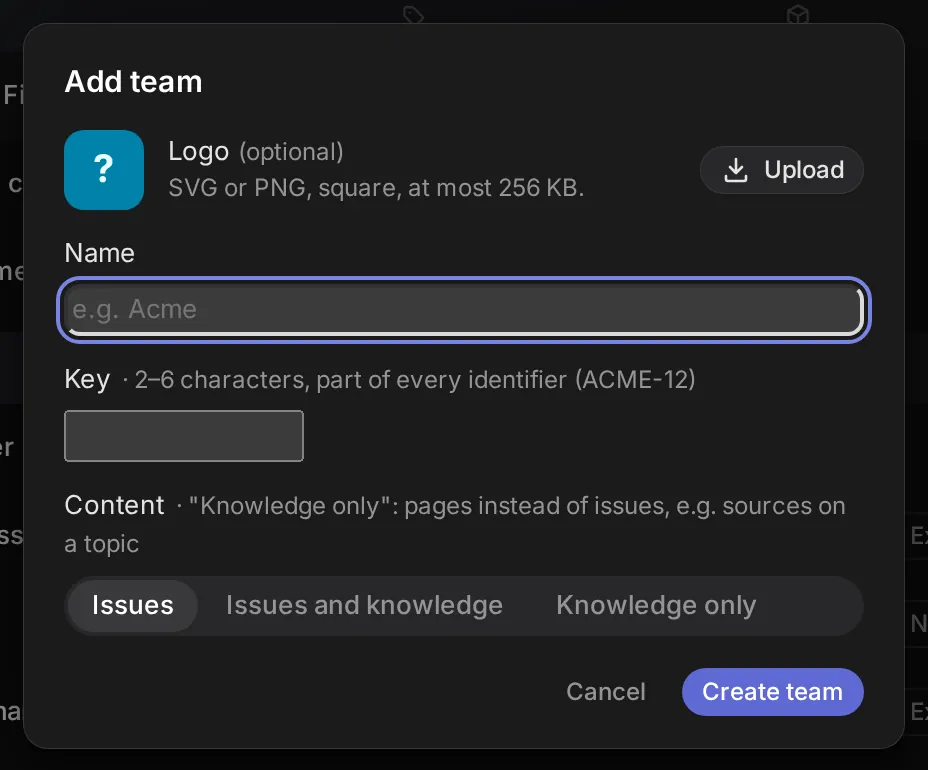

### A2: The focused row is almost invisible in dark mode
Impact high · effort S · visual

- **Where:** all lists and boards. `app.css:71` (`--bg-row-hover`), `.row.focused`, `.card.focused` in
  `board.css`.
- **Problem:** the J/K cursor is `rgb(21,21,22)` on `rgb(15,15,16)`, 1.05 : 1. Light has 1.10 : 1. A group
  header (L 0.205) is brighter than the focused row (L 0.195). The only other cue is the 16 px checkbox.
  The board card has the same 1.05 : 1.
- **Fix:** a token of its own, `--bg-row-focus: oklch(0.225 var(--c) var(--base-hue))` in dark (about
  1.12 : 1), equal to `--bg-row-hover` in light, used by `.row.focused`, `.inbox-row.focused` and
  `.card.focused`. Tabs, crumbs and icon buttons keep today's hover colour. The focused card also gets
  `box-shadow: 0 0 0 1px var(--border-popover)`.

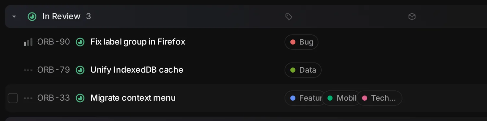

### A3: Light theme: status icons fall below 3 : 1
Impact medium, high for light theme users · effort S · visual

- **Where:** `app.css:152-158` (light overrides), `--status-canceled` has no light value. Rows, group
  headers, board columns, the status picker.
- **Problem:** only the text variants were darkened for light, not the icon colours.

  | Token | Now | On panel | Proposed | On panel |
  |---|---|---|---|---|
  | `--status-progress` | #e8c12f | 1.69 | #ad8200 | 3.43 |
  | `--status-canceled` | #95a2b3 | 2.53 | #7a8696 | 3.61 |
  | `--status-triage`, `--urgent` | #f2632a | 3.11 | #de5219 | 3.84 |
  | `--status-backlog` | #8b8f95 | 3.17 | #7f8389 | 3.72 |
  | `--status-review` | #2f9a68 | 3.45 | #2c9163 | 3.84 |

- **Fix:** the proposed values in the light block, and the same values in `lib/look/map.ts:182` for the
  theme previews.

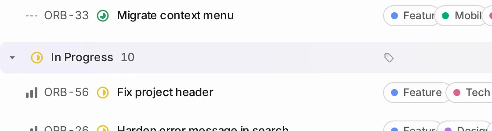

### A4: Controls without any hover feedback, and two hovers that are invisible in one theme
Impact medium · effort S · visual

- **Where:** `.dp-chip`, `.dp-select select`, `.toggle`, `.seg button`, label pills in the properties
  column, `.create-more`; `.row .cell:hover` (`app.css:1171`); `.card-row:hover` (`app.css:2537`).
- **Problem:** the first group does not change at all on hover while `.btn`, `.chip` and `.prop-row` next
  to them do. In light the status and priority cells of a row hover at 1.018 : 1. In dark a settings row
  hovers at 1.019 : 1 and gets darker than its card.
- **Fix:** `.dp-chip:hover, .seg button:not(.on):hover { color: var(--text); }`,
  `.dp-chip:not(.on):hover { background: var(--bg-control); }`,
  `.dp-select select:hover { background: var(--bg-control-on); }`,
  `.prop-labels .pill:hover { background: var(--bg-control); }`, `.toggle:hover { filter: brightness(1.1); }`,
  `--bg-control-on` for the row cell hover in light, `--bg-active` for `.card-row:hover` in dark.

### A5: Board cards: status and priority have no hover and a clipped focus ring
Impact medium · effort S · visual

- **Where:** `board.css:187-189` and `Workflow.svelte:240-242` use `var(--bg-hover)`, which no file
  defines. `.card-bottom { overflow: hidden }` at `board.css:171`.
- **Problem:** hovering the status or priority icon on a card changes nothing, while the same icons in a
  list row get a filled square. The colour swatch in the workflow settings has the same dead hover. The
  keyboard focus ring of these cells is clipped to a sliver.
- **Fix:** `var(--bg-control)` in both places and `.card-bottom .cell:focus-visible { outline-offset: -2px; }`.

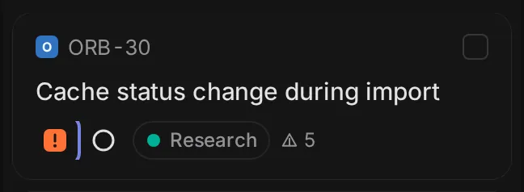

### A6: Pill controls come in four heights, three of them in one row
Impact medium · effort M · visual

- **Where:** 28 px `.btn`, `.icon-btn`, `.input`; 26 px `.tab`, `.chip`, `.dp-chip`, `.dp-select select`,
  `.quick-search`, `.rm-chip`; 24 px `.btn.small`, `.filter-chip`, `.pill`; 22 px `.palette-target`,
  `.pull-issue`, `.budget-chip`.
- **Problem:** the create dialog header puts a 26 px team chip, a 24 px "Save as draft" and a 28 px close
  button side by side. The view bar has 26 px tabs next to 28 px icon buttons. Text fields are rounded
  rectangles or pills depending on the place.
- **Fix:** two interactive heights. 28 px for every control in a bar or dialog (`.tab`, `.chip`, `.dp-chip`,
  `.dp-select select`, `.quick-search`, `.rm-chip`), 24 px for controls inside rows and `.btn.small`.
  22 px and below only for badges that are not buttons. `.quick-search` takes the 8 px radius of `.input`.

### A7: Popovers: three corner radii, seven open without motion
Impact medium · effort S · visual

- **Where:** radius 12 on the palette, pickers and display options; radius 10 on `.link-pop` and
  `.lang-picker`; radius 8 on `.context-menu`, `.submenu` and `.toast`. No enter animation on `.slash-menu`,
  `.table-menu`, `.link-pop`, `.lang-picker`, `.hue-pop`, `.wiki-menu`, `.rx-dialog`. `.wiki-menu` has its
  own surface and shadow.
- **Problem:** the status picker and the right-click menu hold the same 32 px items, one in a 12 px shell,
  the other in an 8 px shell. Typing "/" in the editor makes a menu appear without a transition while
  every other menu drops in over 140 ms.
- **Fix:** `var(--radius-lg)` for all of them, `animation: drop var(--dur-2) var(--ease-out)` for the six
  popovers, `pop var(--dur-3) var(--ease-out)` for `.rx-dialog`, `--bg-popover` and `--shadow-popover` for
  `.wiki-menu`.

### A8: Buttons fade their hover in over 140 ms; hard-coded durations sit next to the tokens
Impact medium · effort S · visual

- **Where:** `.icon-btn` (`app.css:896`), `.tab` (`:962`), `.btn` (`:1913`), `.chip` (`overlays.css:144`),
  `.add-team`. Literals: `0.15s ease-out` on `.nav-item`, `.row`, `.inbox-row`; `0.1s` on carets and
  `.toggle`; `0.12s` in `md.css`; `0.2s` for the drawer.
- **Problem:** rows and sidebar items switch their hover on at once and fade out. Buttons fade in too, so
  a button answers the pointer later than a row. Chevrons rotate in four different ways.
- **Fix:** `:hover { transition-duration: 0s; }` for the five button kinds. Replace the literals with
  `--dur-1`, `--dur-2`, `--dur-3` and `--ease-out`. All chevrons use `transform var(--dur-2) var(--ease-out)`.

### A9: Text fields show focus in three ways, two of them not at all
Impact medium · effort S · visual

- **Where:** `.input:focus` has a 1 px inset ring. `.quick-search` (`app.css:1019`), `.comment-box textarea`
  (`detail.css:318`), `.link-pop input` and `.lang-search` set `outline: none` and nothing else. The task
  checkbox (`md.css:194`) and the callout icon use `--accent` for the ring.
- **Problem:** after Tab into the comment box or the list filter field only the caret shows where the focus
  is. In dark `--accent` reaches 3.11 : 1 on control surfaces, `--focus-ring` 4.40 : 1.
- **Fix:** `box-shadow: inset 0 0 0 1px var(--focus-ring)` on `:focus` for the three fields and on
  `.comment-box:focus-within`. Both `--accent` outlines become `--focus-ring`.

### A10: Remaining contrast failures
Impact medium · effort S · visual

- **Where and problem:**
  - Team logo letters in light: 3.04 to 3.66 : 1 at 8 to 12 px bold (`app.css:783`).
  - `.input` has no placeholder rule, so Chromium's grey applies: 3.20 : 1 on dark controls.
  - `--text-faint` is documented as "never for readable text" but colours `.pull-owner`, `.pulls-head-note`
    ("last 14 days") and the inherited model name in rows: 2.61 : 1 dark, 2.77 : 1 light.
  - Column icons in group headers: 2.61 : 1. They are the only label of the columns.
- **Fix:** logo background `oklch(0.52 0.14 var(--hue))` in both themes, `.input::placeholder { color:
  var(--text-subtle); }`, the three texts to `--text-subtle`, `.group-cols, .group-end { color:
  var(--text-subtle); }`.

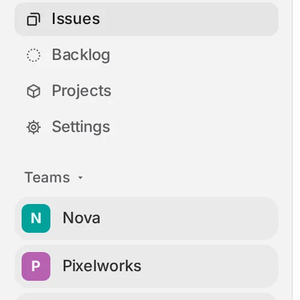
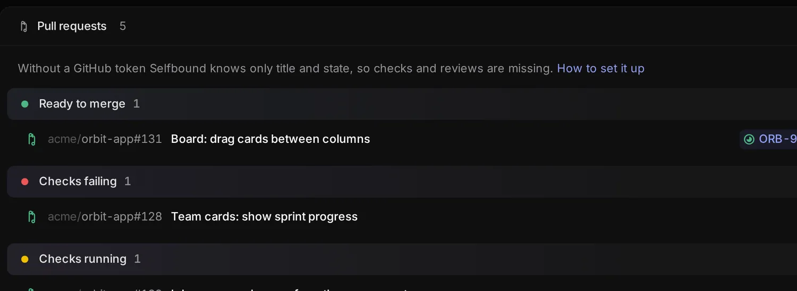

### A11: One icon for several meanings, two icons for one
Impact medium · effort M · visual

- **Where:** `core/src/icons.ts`, `core/src/app/actions.ts`.
- **Problem:** `duplicate` and `copy` are the same path. `eye` stands for "Preview", "Public on the roadmap"
  and "Mark as read". `restore` stands for "Restore" and "Repeat". `blocked` stands for "Blocks" and
  "Blocked by". `parent` and `subissue` differ by 2 px. "Set priority …" shows a gauge while priority is
  bars everywhere else. "Open as a page" beside the inbox and "Open on GitHub" beside the pull request
  list share `ICON.open`. Upload buttons carry the download arrow.
- **Fix:** `duplicate` reuses the status shape, "Public on the roadmap" gets `roadmap`, "Mark as read"
  `check`, "Repeat" a two-arrow loop, "Blocks" `warning`, `subissue` a fork, "Set priority …" the bars,
  "Open as a page" `expand`, uploads `arrowUp`. New paths cost a few hundred bytes in the start bundle and
  have to be paid for there.

### A12: Hard-coded font sizes ignore the font size setting
Impact low · effort S · visual

- **Where:** `.tc-stats` 12 px (`app.css:721`), `.ws-name` 14, `.help-btn` 11, `.create-title` 18,
  `.peek-title` 17, `Workflow.svelte:272`, editor menus. Weights 500, 560, 600, 650 next to the scale
  450, 510, 590.
- **Problem:** with font size "Large" the sidebar counts grow and the sprint line under the team name does
  not. The description is 15 px in the create dialog and 14 px once the issue exists.
- **Fix:** the tokens `--fs-mini`, `--fs-regular`, `--fs-micro`; one new `--fs-heading: 18px` for the create
  and peek titles; `.create-desc` to `--fs-regular`; weights to 510 and 590.

### A13: Reduced motion moves the image viewer's arrows
Impact low · effort S · visual

- **Where:** `app.css:3143` sets `translate: none !important` under `prefers-reduced-motion`.
  `.img-viewer-nav` centres itself with `translate: 0 -50%` (`pr.css:619`). Found in the code, not
  reproduced.
- **Fix:** `.img-viewer-nav { top: calc(50% - 20px); }` without `translate`.

---

## B. Lists, board and view bar

### B1: Date column: year cut off, two date columns overlap, German dates ragged
Impact high · effort S · visual

- **Where:** `app.css:1518` (`.row-date { width: 44px }`), `app/src/lib/columns.ts:23` (`END_WIDTH = 44`),
  `core/src/format.ts:94` (`shortDate`).
- **Problem:** the cell is 44 px and `nowrap`. "Dec 22, 2025" is 80 px, runs 36 px out of its cell and the
  row cuts it to "Dec 22, 202". With "Created" and "Updated" both shown, two such dates print over each
  other. In the split view the cut comes after "Dec 22, 20". In German "19. März" (52 px) and "13. Sep."
  (47 px) stick out while "7. Apr." is right-aligned.
- **Fix:** 52 px for `.row-date`, `.group-end > .c` and `END_WIDTH`, which fits every current-year date in
  both languages. Dates from another year read "Dec ’25" / "Dez. ’25" in the row, with the full date in the
  tooltip.

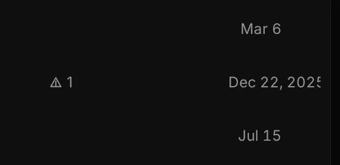
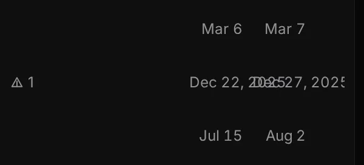

### B2: Display options cannot be used with the keyboard
Impact high · effort S · friction · Decision for the focus part

- **Where:** Shift V, `DisplayPopover.svelte:26`, `core/src/app/actions.ts:343`.
- **Problem:** after Shift V the focus stays on the page. Tab lands on list rows, J/K keep moving the list.
  Grouping and ordering have no command menu entry, only "Board columns" has one.
- **Fix:** commands "Group by …" / "Gruppieren nach …" and "Sort by …" / "Sortieren nach …" as pickers over
  the view's groupings and orderings. With a yes from the owner, Shift V also moves the focus to the first
  select and returns it to the list on close.

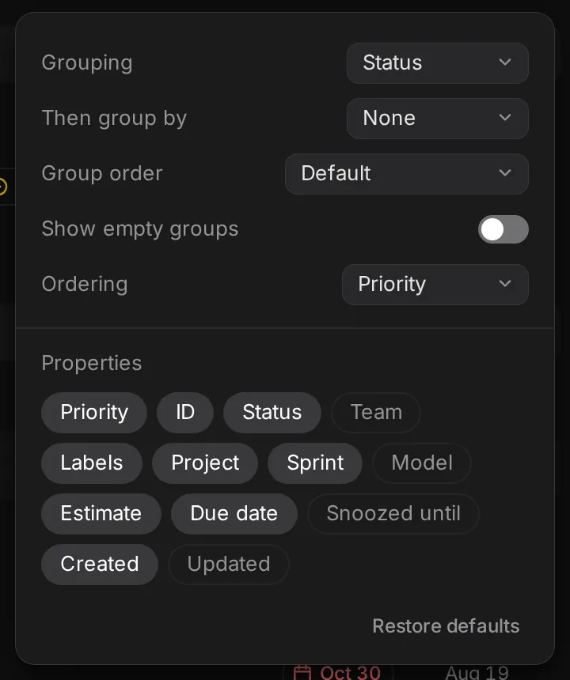

### B3: Label chips are cut mid-letter
Impact medium · effort S · visual

- **Where:** `app.css:1400` (`.lstack .label { text-overflow: clip }`), `columns.ts:15` (`labels: 184`).
- **Problem:** "Feature", "Design", "Release" need 213 px, the column has 184 px. Only the last chip gets
  "…", the others read "Featur" and "Desig". At 1920 px there are 600 px of free room next to the title and
  the chips are still cut.
- **Fix:** `text-overflow: ellipsis` on every chip of the stack in rows and cards. A fourth column stage
  with `--cw-labels: 264px` once the list is wide enough is the second step (M).

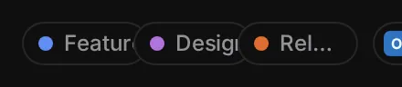

### B4: A selection has no count
Impact medium · effort S · friction

- **Where:** X, Shift J/K, Ctrl A. `ListPage.svelte:81`.
- **Problem:** nothing says how many issues are selected. After Ctrl A the view bar still reads "26 issues".
- **Fix:** while something is selected the count reads "3 of 26 selected" / "3 von 26 ausgewählt" in the
  accent text colour, with a small × that clears like Esc.

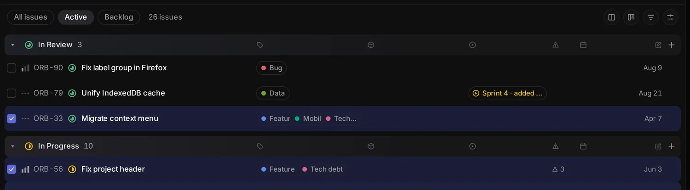

### B5: Group headers: the "Created" icon looks like a button, icons label nothing on closed and empty groups
Impact medium · effort S · visual

- **Where:** `columns.ts:73` (`created: 'ui-compose'`), `GroupRow.svelte:92`, `app.css:1588`.
- **Problem:** the column icon for "Created" is the "New issue" icon, 4 px left of the "+", and it does
  nothing. Collapsed and empty groups show all six column icons above nothing. With a second grouping level
  every sub-header repeats them: 7 of 18 visible lines are headers with 42 icons. Sub-headers are indented
  16 px, their rows are not.
- **Fix:** a clock icon for "Created". Column icons only on open, non-empty first-level headers. Second-level
  rows indent with their header.

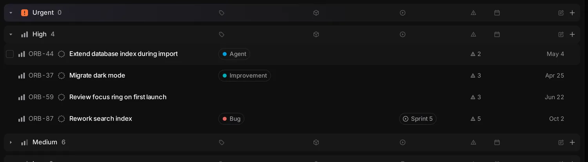
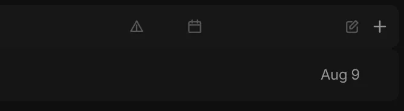

### B6: The priority limit text sits on every team header and turns orange as a whole
Impact medium · effort S · visual · Decision for hiding it below the limit

- **Where:** `/all`, `/triage`, lists grouped by team. `GroupRow.svelte:90`, `core/src/budget.ts:41`.
- **Problem:** every team header carries "Urgent 1/1 · High 9/3" as the brightest text of the header, also
  for a group of one issue. "Urgent 0/1 · High 6/3" is orange in full although only High is over. "9/3"
  reads like a fraction.
- **Fix:** colour only the part that is over and write "High 9 of 3" / "Hoch 9 von 3". With a yes from the
  owner, show the text only when a limit is reached and keep the full sentence in the tooltip.

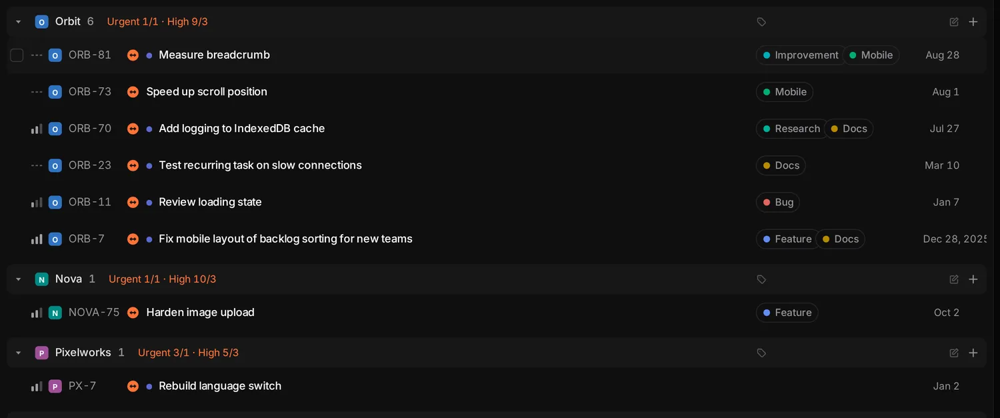

### B7: The unread dot pushes the title 15 px to the right
Impact medium · effort S · visual

- **Where:** `app/src/lib/rowHtml.ts:139`, `.unseen-dot` in `app.css:1224`.
- **Problem:** titles start at x = 385 without the dot and at 400 with it, so the title edge is ragged
  wherever read and unread rows mix.
- **Fix:** emit the dot after the title, where "saving" already goes.

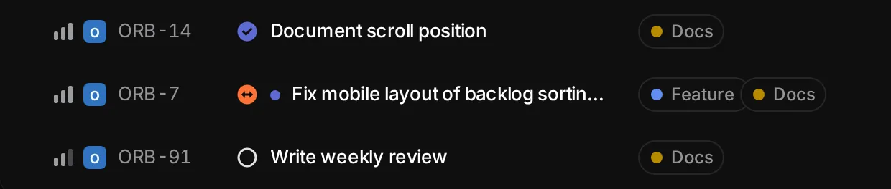

### B8: Narrow lists show a slice of the due pill instead of dropping it
Impact medium · effort S · visual

- **Where:** split view with the divider dragged left, sprint planning at 1024 px. `app.css:1257`
  (`.row-cols { min-width: 0; overflow: hidden }`), `SplitView.svelte:19` (`LIST_MIN = 320`).
- **Problem:** the first column cannot wrap away and is clipped: 13 to 55 px of the due pill remain. At
  320 px only "All issues" fits in the tabs and the active tab is clipped away.
- **Fix:** `.row-cols { min-width: min-content; }` in the base rule, as the phone block already has it, so
  the title gives way first. `LIST_MIN` and the `clamp()` minimum go from 320 to 380 px.

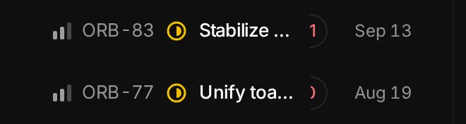

### B9: "Sprint 4 · added late" never fits its column
Impact low to medium · effort S · text

- **Where:** `columns.ts:17` (`sprint: 136`), `rowHtml.ts:26`.
- **Problem:** the pill needs 146 px in English and 158 px in German. It always reads "added …" or
  "nachtr…", the part the yellow stands for.
- **Fix:** "Sprint 4 · late" / "Sprint 4 · spät" in the row, the full wording in the tooltip. The column
  width stays, so titles lose nothing.

### B10: Columns repeat what the group header says
Impact low to medium · effort S · visual

- **Where:** `/all`, `/triage`, lists grouped by project or sprint. `ListView.svelte:48`.
- **Problem:** grouped by team, every row repeats the header's team logo. Grouped by project, every row
  repeats the project pill in a 168 px column.
- **Fix:** drop the grouped-by property from the shown properties for team, project and sprint. The project
  view already does this for its own project.

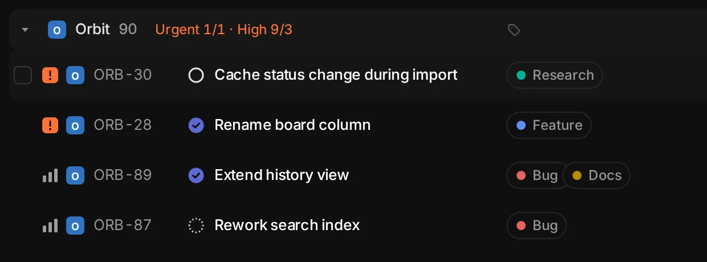

### B11: Board columns are fixed at 320 px
Impact medium for board use · effort S · visual

- **Where:** `board.css:14`.
- **Problem:** "Active" has three columns and 680 px of dead space at 1920. "All issues" has 1484 px of
  columns in 1188 px, so "In Review" is cut and the collapsed columns are off screen.
- **Fix:** `.board-column { flex: 1 1 320px; min-width: 260px; max-width: 440px; }`, collapsed stays 44 px.

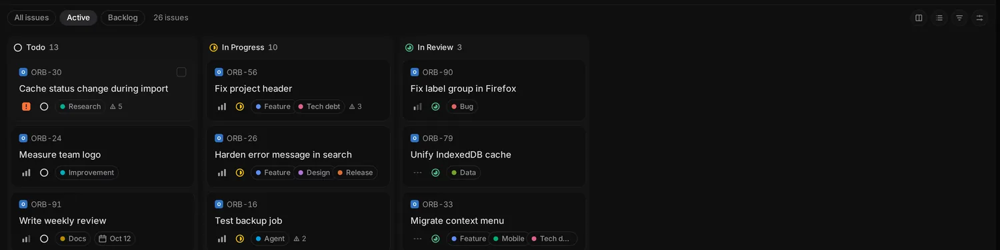

### B12: The filter badge counts values, the bar shows fields
Impact low · effort S · friction

- **Where:** `core/src/query.ts:51` (`filterCount`), `ListPage.svelte:111`.
- **Problem:** two priorities and two labels show two chips and a badge "4". A chip is a `span`, only its ×
  reacts.
- **Fix:** the badge counts fields. A click on the chip text opens the filter picker at that field (M).

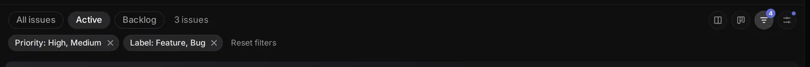

### B13: Shift-click leaves a browser text selection over the rows
Impact low · effort S · visual

- **Where:** `IssueRow.svelte:58`.
- **Problem:** Shift-click extends the native text selection across the rows in between, on top of the row
  selection. Ctrl C then copies that text instead of the identifiers.
- **Fix:** one `mousedown` listener on the list that calls `preventDefault()` when Shift is held.

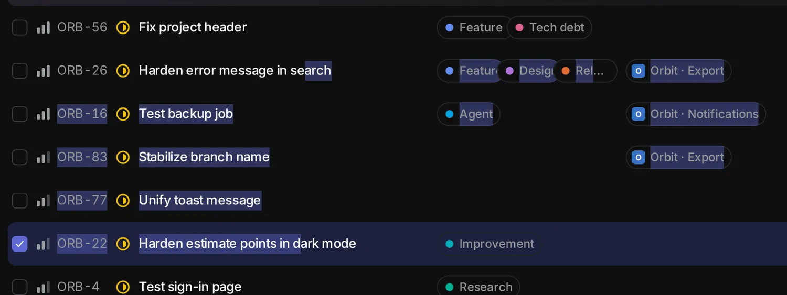

### B14: Display options: four label forms in English, two labels collide in German
Impact medium · effort S · text

- **Where:** `DisplayPopover.svelte:28-76`, `locales/de/components.ts:80`, `.dp-row` at `app.css:2320`.
- **Problem:** English mixes "Grouping", "Then group by", "Group order", "Ordering". German "Danach
  gruppieren nach" and "Reihenfolge der Gruppen" wrap to two lines that touch. The selects are as wide as
  their longest option, so their left edges sit at four different x positions.
- **Fix:** "Group by", "Then by", "Group order", "Sort by" / "Gruppieren nach", "Dann nach", "Gruppenfolge",
  "Sortieren nach". Labels do not wrap. `.dp-select select { min-width: 156px; }`.

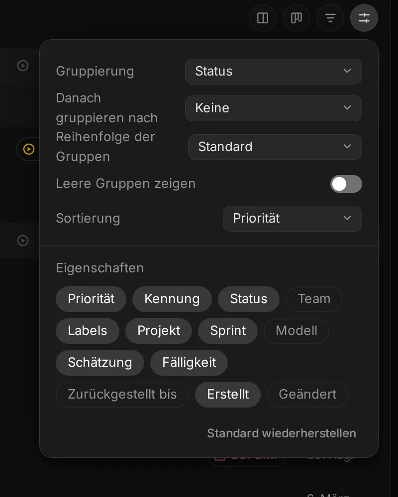

### B15: In split lists a hovered row has no hover background
Impact medium · effort S · visual

- **Where:** inbox and every split list. `app.css:1707`, `:1828`.
- **Problem:** the mouse does not move the focus in split view, which is intended. But then a hovered row
  shows nothing, although a click switches the issue. The divider's highlight fades in and snaps off,
  because its transition is declared inside `:hover`.
- **Fix:** `.split.on :is(.row, .inbox-row):hover:not(.focused) { background: color-mix(in oklch,
  var(--bg-row-hover) 60%, transparent); }` and the transition moves to `.split-handle`.

### B16: A collapsed group can only be reopened with the mouse
Impact low · effort S · friction

- **Where:** T, `core/src/app/list.ts:934`.
- **Problem:** J/K skip collapsed groups, so after moving on a second T collapses the next group.
- **Fix:** a command "Expand all groups" / "Alle Gruppen aufklappen" without a shortcut.

### B17: Switching to the board drops the triage issues without a word
Impact low · effort S · friction · Decision

- **Where:** Ctrl B on "All issues". `core/src/views.ts:148` (`boardTypes`).
- **Problem:** the list says "90 issues" with a Triage group of 6, the board says "84 issues" and has no
  Triage column.
- **Fix:** the count reads "84 issues · 6 in triage" / "84 Issues · 6 in Triage", or a collapsed Triage
  column.

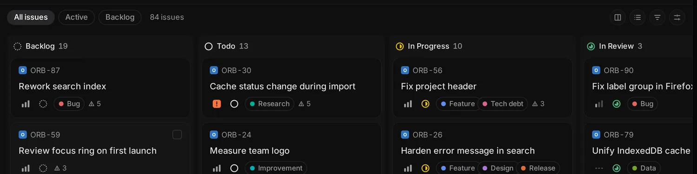

### B18: Board cards repeat team logo and status icon
Impact low · effort S · visual · Decision for the status icon

- **Where:** `components/board/Card.svelte`.
- **Problem:** in a team board every card starts with the same logo. In status columns every card repeats
  its column's status icon.
- **Fix:** the logo only on cross-team boards. With a yes, the status icon only when the columns are
  priorities; it is a click target today.

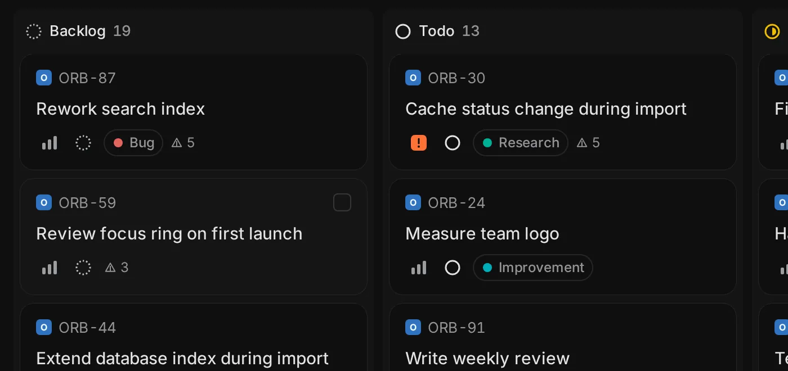

### B19: No group context after scrolling
Impact low to medium · effort M · friction · Decision

- **Where:** `app.css:1581`. Nothing in the list is sticky.
- **Problem:** in a group longer than the window neither the group name nor the column icons are visible.
- **Fix:** one overlay header that shows the group of the first visible row. It costs one lookup per scroll
  frame, so it needs a measurement before it ships.

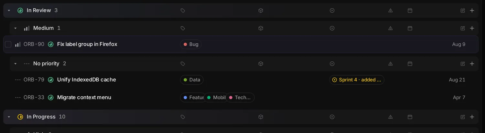

### B20: Wide windows: up to 1850 px of empty row between a title and its labels
Impact medium on a large monitor · effort S · visual

- **Where:** any list at 1920 and 2560. `app.css:1257` pins the columns to the right edge.
- **Problem:** the largest gap between the end of a title and the first column is 738 px at 1440, 1218 px at
  1920 and 1858 px at 2560. The issue page, settings, dialogs and menus all hold their width, only the list
  stretches.
- **Fix:** cap the row content: `.list { --row-max: 1280px; }` and rows and group headers end at
  `max(4px, calc(100% - var(--row-max)))`. Nothing changes up to a 1530 px window.

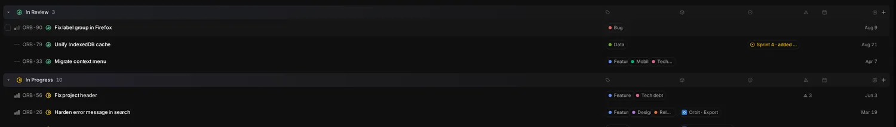

---

## C. Issue page, peek and create dialog

### C1: The create dialog has three exits, two of them identical
Impact high · effort S · friction · Decision

- **Where:** `CreateDialog.svelte:80` ("Save as draft"), `:82` (×), `:128` ("Discard");
  `core/src/app/create.ts:385`, `:397`.
- **Problem:** "Save as draft", ×, Esc and a click outside all call `create.close()`. Two of them are
  adjacent buttons. With an empty dialog "Save as draft" saves nothing. "Discard", the one exit that loses
  text, is a ghost button next to "Image" with the same look, and it shows even when there is nothing to
  discard. The two tooltips describe the same action in different words.
- **Fix:** remove the "Save as draft" button; ×, Esc and click outside keep the draft and keep showing the
  toast "Saved as draft · Open". "Discard" appears only when the draft has content, reads "Discard draft" /
  "Entwurf verwerfen" and moves to the right group. × tooltip: "Close · Esc (kept as draft)" / "Schließen ·
  Esc (bleibt als Entwurf)".

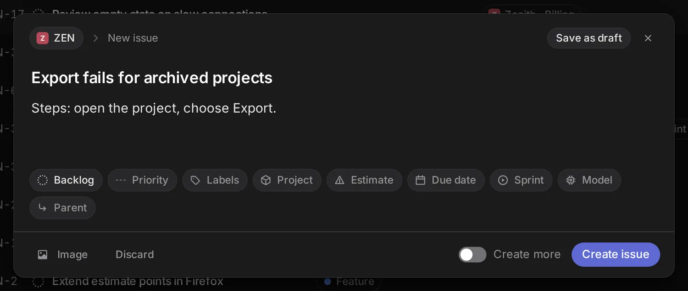

### C2: The properties column shows the same kind of field in two layouts
Impact high · effort S · visual

- **Where:** `Properties.svelte:28-42` (plain rows), `:56-74` (caption plus row), `detail.css:379`.
- **Problem:** status, priority, estimate, due date and snooze are single 30 px rows. Project, sprint, model
  and parent are a caption plus a row, 54 px each, and when empty the caption and the placeholder say the
  same thing twice ("Project" / "Choose project"). The card is 234 px for four fields, 138 px as plain rows.
  Empty fields use four verbs: "Set estimate", "Choose project", "Add to sprint", "Snooze". The same fields
  are plain nouns in the create dialog.
- **Fix:** drop the four captions. An empty field shows its noun in muted text, as the create chips do:
  "Priority", "Estimate", "Due date", "Snooze", "Project", "Sprint", "Model", "Parent" / "Priorität",
  "Schätzung", "Fälligkeit", "Zurückstellen", "Projekt", "Sprint", "Modell", "Parent-Issue". The "Labels"
  caption and the model note stay.

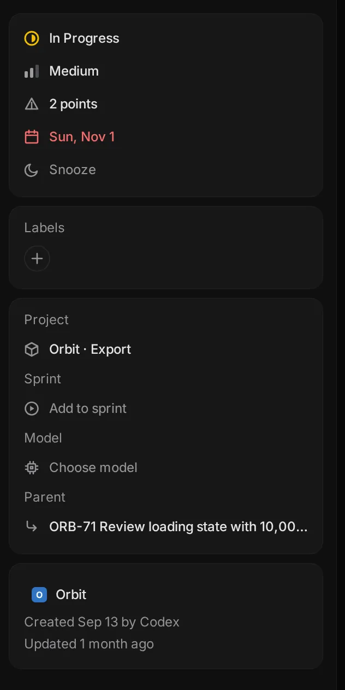

### C3: Esc saves in the description but throws the text away when editing a comment
Impact high · effort S · friction · Decision

- **Where:** `Activity.svelte:148-150` (`onescape` sets `editing = null`), `Description.svelte:101`.
- **Problem:** on one page Esc means "save and close" in the description, "leave the field, keep the draft"
  in the new comment box and "discard" in the comment edit box. Edit, type a sentence, Esc: the old text is
  back, no toast, no draft, no undo. The edit box has no hint that Ctrl Enter saves.
- **Fix:** Esc never loses text. In the comment edit box Esc saves changed text and closes unchanged text.
  "Cancel" stays as the explicit discard with a toast "Changes discarded · Undo". A hint "Ctrl Enter to
  save" sits left of "Cancel".

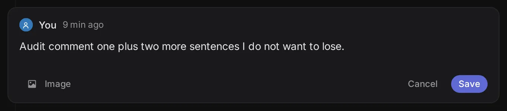

### C4: Writing a comment needs the mouse or about 40 Tab presses
Impact high · effort S · friction · Decision

- **Where:** `/issue/<KEY>`. No action in `core/src/app/actions.ts` focuses the comment box.
- **Problem:** from a freshly opened issue the comment box is around Tab stop 40, 29 of them in the sidebar.
  The command menu has no entry either.
- **Fix:** action `issue.comment`, "Write comment" / "Kommentar schreiben", on the issue page and in the
  split view. From the list it opens the issue and focuses the box. Proposed key R, which no action uses.
  Independently of the key, the first Tab on an issue page should land on the title, not in the sidebar.

### C5: The editor status row is off screen on long texts, shifts the page 32 px, and its hint is long
Impact medium · effort S · visual

- **Where:** `Description.svelte:109-115`, `detail.css:100` (`.desc-tools`).
- **Problem:** the row with "Unsaved / Saving … / Saved automatically" and "Done" sits after the text, so on
  a long description the save state is below the fold. Starting and ending the editor moves everything below
  by 32 px. The hint `"/" blocks · Ctrl B / I / K · images with Ctrl V · Esc done` is 300 px of permanent
  text next to a "Done" button.
- **Fix:** `.desc-tools { position: sticky; bottom: 0; background: var(--bg-panel); }` and a negative margin
  on `.desc.edit` so nothing below moves. The hint shrinks to `"/" for blocks` / `„/“ für Blöcke`, the
  button tooltip reads "Done · Esc".

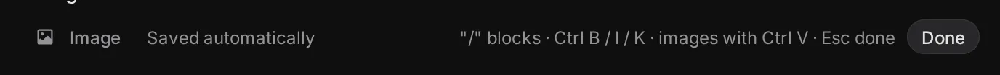

### C6: With the peek open, a picker is partly covered by the peek card
Impact medium · effort S · visual

- **Where:** Space, then S, P or L. `overlays.css:31` (`.peek.beside-palette`).
- **Problem:** the 520 px peek is drawn above the centered 640 px picker. They overlap by 232 px at 1280 and
  152 px at 1440, where the digit hints 1 to 4 of the status picker are hidden.
- **Fix:** below 1700 px the peek hides while a centered picker is open. The picker header already names the
  issue.

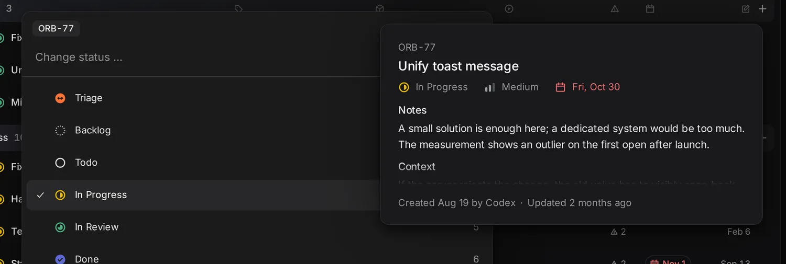

### C7: Sub-issue and relation rows cannot be reached with the keyboard
Impact medium · effort S · friction

- **Where:** `IssuePage.svelte:169`, `:186` (`
`), `detail.css:132`.
- **Problem:** Tab goes from "Create sub-issue" straight to the comment tools. The rows are `div`s with a
  click handler and `cursor: default`. The knowledge rows right below are links and work with Tab, Enter and
  Ctrl click. The column order also differs from the list: priority, status, key, title.
- **Fix:** render both as `<a class="sub-row" href="/issue/{key}">` with the click handler of
  `IssueKnowledge.svelte`, in list order: priority, key, status, title.

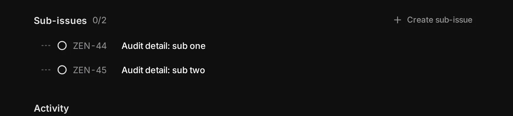

### C8: The ninth chip in the create dialog always wraps onto its own line
Impact medium · effort S · visual

- **Where:** `overlays.css:110` (`.create { width: 760px }`), `:198` (`.create-chips`).
- **Problem:** eight chips end at x = 1039 in English and 1058 in German of 1082, so "Parent" sits alone in
  a second row and the dialog is 32 px taller than needed.
- **Fix:** `.create { width: 820px; }` and `.create-chips { gap: 5px; }`.

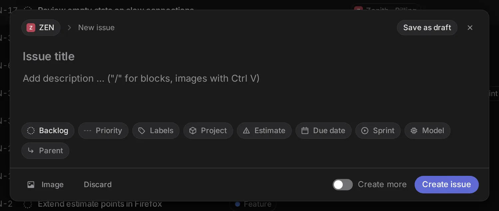

### C9: The same properties come in three different orders
Impact medium · effort S · visual

- **Where:** `Properties.svelte`, `IssuePage.svelte:139-151` (chips above the description),
  `CreateDialog.svelte:112-124`.
- **Problem:** the column, the chips in the narrow layout and the create dialog each order the fields
  differently. The narrow layout has no parent chip, and six of its nine chips are usually empty
  placeholders in two rows between title and text.
- **Fix:** one order everywhere: status, priority, labels, project, sprint, estimate, due, snooze, model,
  parent. The narrow layout gets the parent chip and puts set chips first.

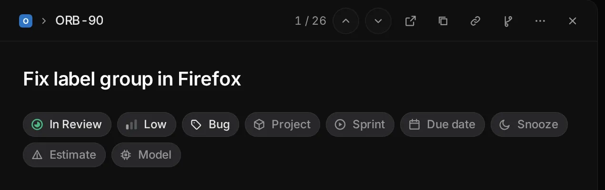

### C10: Every issue shows an empty "Sub-issues" section; "Relations" has no way to add one
Impact medium · effort S · visual · Decision

- **Where:** `IssuePage.svelte:158-164`, `:179`.
- **Problem:** the heading with "Create sub-issue" takes 52 px on every issue, sub-issues included.
  "Relations" works the other way round: shown only when filled, with no add control.
- **Fix:** both sections show only when they have rows, each with a small "+" at the right of its heading.
  Without rows the "…" menu, the command menu and Ctrl Shift O remain.

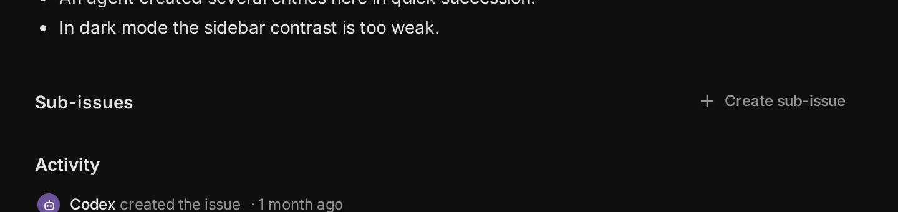

### C11: A sub-issue created on the issue page answers with a toast instead of the new row
Impact medium · effort S · friction

- **Where:** Ctrl Shift O, `core/src/app/create.ts:370`.
- **Problem:** the "is it visible?" check only knows the list page. On the issue page every new sub-issue
  raises "created · Open", even when its row appears 300 px away. When the sub-issue list is below the fold
  the page does not scroll to it.
- **Fix:** when the open issue is the parent, skip the toast, scroll the sub-issue list into view and
  highlight the new row briefly.

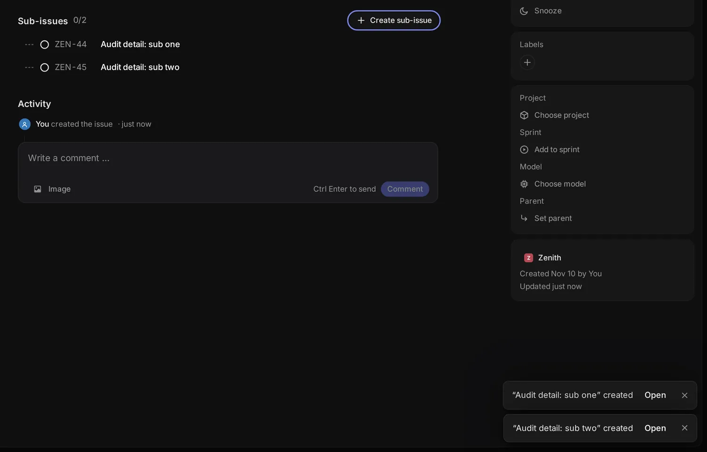

### C12: Deleting a comment: the confirm stays armed forever and loses its red on hover
Impact medium · effort S · friction

- **Where:** `Activity.svelte:129-133`, `app.css:1936` (`.btn.ghost:hover`) against `:1940` (`.btn.danger`).
- **Problem:** after one click "Delete" becomes "Really delete" and stays that way, also after the mouse has
  left and the tools have faded out. On hover the red text turns into normal text colour.
- **Fix:** disarm on `mouseleave`, on blur and after 4 s. `.btn.ghost.danger:hover` keeps the danger colour
  on a 14 % danger tint.

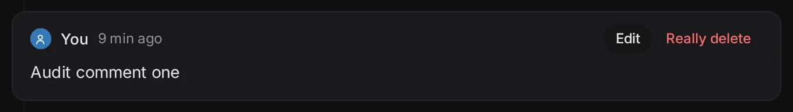

### C13: After Esc the whole description gets a bright focus frame
Impact medium · effort S · visual

- **Where:** `detail.css:75-78`, `app/src/lib/bodyView.ts:31` (`focusReturn`).
- **Problem:** Esc returns the focus to the rendered text, which then shows the 2 px ring around the whole
  block, 680 × 490 px, until the next click or Tab.
- **Fix:** `focusReturn` marks the element until blur; in that state the ring is off and the tint stays.
  Reaching the text with Tab keeps the ring.

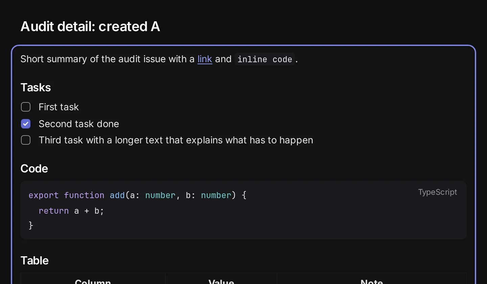

### C14: "Please enter a title" appears in the footer, 215 px below the title field
Impact low to medium · effort S · visual

- **Where:** Ctrl Enter without a title. `CreateDialog.svelte:129`, `overlays.css:211`.
- **Problem:** the error is 12 px red text between "Discard" and "Create more" while the focus jumps to the
  title, which does not change.
- **Fix:** the title placeholder reads "Title is required" / "Titel fehlt" in the danger colour until the
  first keystroke. The footer slot stays for server and limit errors, with ellipsis and a tooltip.

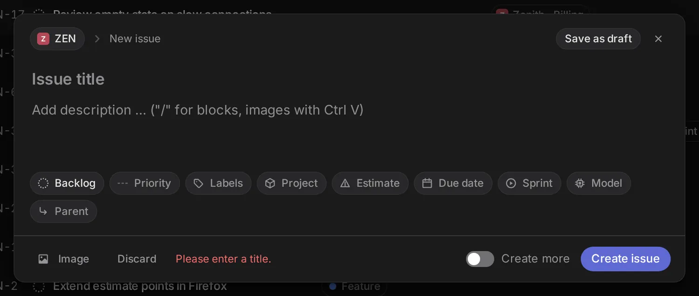

### C15: A draft with chips but no text is dropped without a word
Impact low to medium · effort S · friction

- **Where:** `core/src/app/create.ts:75` (`hasContent` = title or description).
- **Problem:** C, set priority "High", Esc: the dialog closes, no draft, no toast. C again shows an empty
  dialog.
- **Fix:** a draft counts as content when a property differs from the context defaults. Esc keeps it as the
  open draft, without a saved-drafts entry or toast.

### C16: The header repeats the title that stands 60 px below it
Impact low to medium · effort S · visual

- **Where:** `IssuePage.svelte:57`.
- **Problem:** the breadcrumb reads "Orbit › ORB-83 Stabilize branch name", the page title right below reads
  the same.
- **Fix:** the crumb title shows only while the page title is scrolled out of view. The split view already
  hides it.

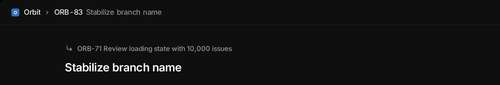

### C17: Two removals give no feedback: relation × and "Delete" on a draft
Impact low to medium · effort S · friction

- **Where:** `IssuePage.svelte:190` → `core/src/app/edit.ts:464`; `DraftsPage.svelte:33` →
  `core/src/app/create.ts:144`.
- **Problem:** the × on a relation removes it at once. An undo entry exists, but no toast says so. "Delete"
  on the drafts page sits 8 px right of "Open" and removes the draft for good.
- **Fix:** toast "Relation removed · Undo" and toast "Draft deleted · Undo" / "Entwurf gelöscht ·
  Rückgängig" that puts the draft back.

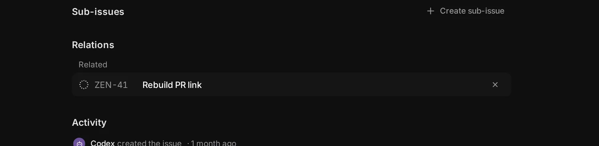

### C18: The "…" menu on the issue page has 22 entries, 14 of them visible right next to it
Impact low to medium · effort M · friction · Decision

- **Where:** `IssuePage.svelte:82-90` opens the list context menu.
- **Problem:** the menu is 767 px tall. Eleven entries repeat the properties column below it, three repeat
  the copy buttons to its left. What only this menu offers starts at entry 13.
- **Fix:** on the issue page leave out the property and copy groups, which leaves about eight entries.

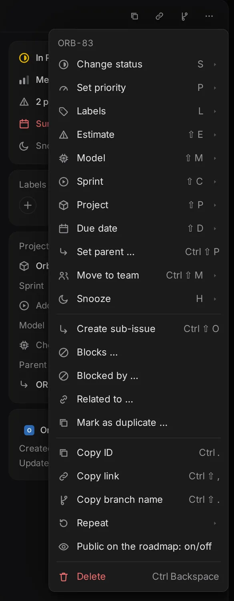

### C19: The conflict notice is inserted above the text being typed
Impact low · effort S · visual

- **Where:** `Description.svelte:86-92`, `detail.css:109`.
- **Problem:** when a foreign change arrives the notice appears above the editor and moves the text under
  the cursor down by 72 px. With a second tab of the same user it reads "You just changed the description
  while you were typing."
- **Fix:** render the notice below the text, in the sticky status area of C5. For the owner as actor: "The
  description was changed in another window while you were typing. Your text is not lost." / "Die
  Beschreibung wurde in einem anderen Fenster geändert, während du tippst. Dein Text ist nicht verloren."

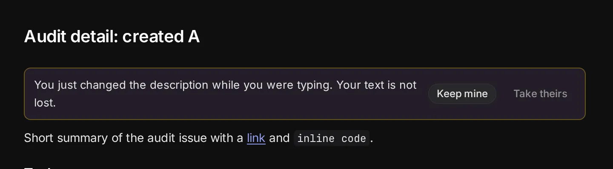

### C20: The peek card changes height on every J/K
Impact low · effort S · visual

- **Where:** `Peek.svelte:28-45`, `overlays.css:76`.
- **Problem:** paging six issues gave card heights of 221, 221, 340, 340, 307 and 273 px. The sprint reads
  "Sprint 4 (added late)" here and "Sprint 4 · added late" elsewhere.
- **Fix:** `.peek-desc { min-height: 112px; }`, also for "No description.", and " · " as elsewhere.

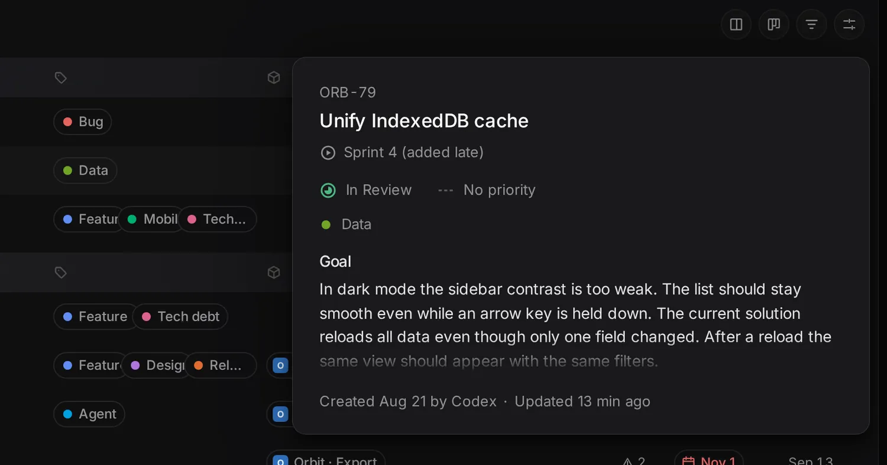

### C21: Small misalignments in the properties column
Impact low · effort S · visual

- **Where:** `Properties.svelte:80`, `detail.css:433`, `IssuePublic.svelte:107`, `:153`.
- **Problem:** the team row starts 8 px right of every other row and its hover area is 16 px narrower. The
  Roadmap card's captions are weight 590, the other cards' are regular. "Remove" under the cover image is
  indented 10 px from the image edge.
- **Fix:** `.prop-meta .prop-row { margin: 0 -8px; width: calc(100% + 16px); }`, `.pub-field-label {
  font-weight: 450; }`, "Remove" and "Upload image" in one row as small buttons.

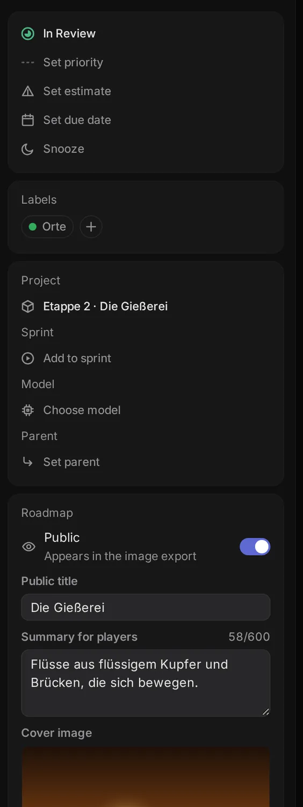

### C22: Checked tasks look different in the editor and in the rendered text
Impact low · effort S · visual

- **Where:** `md.css:163-180`, `RichEditor.svelte:838-852`.
- **Problem:** in the editor a done task is muted and struck through, in the rendered view it is normal
  text. The task text also moves 3.5 px on entering the editor.
- **Fix:** `.md li.task:has(> input:checked)` gets the muted, struck-through look, and the checkbox gap is
  aligned.

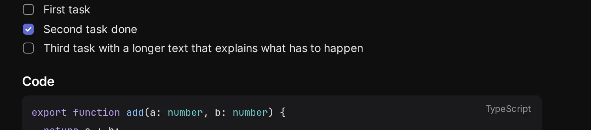
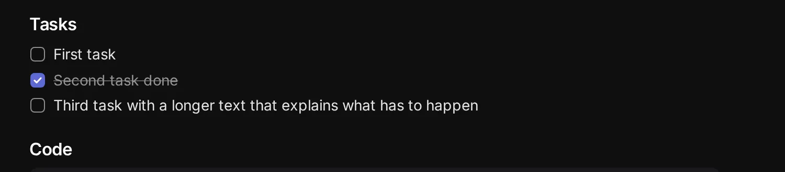

### C23: Closing any editor throws an uncaught Svelte error
Impact low · effort S · friction

- **Where:** `RichEditor.svelte:633-640`. The ProseMirror `blur` handler writes `$state` during teardown.
- **Problem:** every Esc or "Done" logs `state_unsafe_mutation` in the dev build. Nothing is lost, but the
  queued `syncTable` is skipped. Not checked in a production build.
- **Fix:** a plain `destroyed` flag set before `view.destroy()`; the blur handler returns early after
  `flush()` and `onblur` when it is set.

---

## D. Menus, pickers and keyboard

### Keystrokes for ten daily tasks

| Task | Keyboard | Mouse | Wasted step |
|---|---|---|---|
| Create an issue with title, priority, label | C, title, Tab ×3, Enter, 2, Tab, Enter, "bug", Enter, Esc, Ctrl Enter: 14 keys | 7 clicks | two Tabs across description and status; Esc to leave the label picker (D12) |
| Three issues to Done | X, Shift J, Shift J, S, 6: 5 keys | 5 clicks | none; the selection has no count (B4) |
| Into the current sprint | Shift C, ↓, Enter: 3 keys | 2 clicks | ↓ because "No sprint" is highlighted (D23) |
| Find by a word and open | /, word, Enter | 2 clicks | none, first hits after 13 ms |
| Due next Friday | Shift D, "fri", Enter: 5 keys | 2 to 3 clicks | "next friday" finds nothing (D10) |
| Comment on the focused issue | Enter, 40 × Tab, text, Ctrl Enter | 3 clicks | no shortcut (C4) |
| Filter Bug + High, clear again | 11 keys, then 7 to clear | 7 clicks, 1 to clear | the picker closes after each typed pick; no key to clear (D14) |
| Undo | Ctrl Z | 1 click in the toast | none |
| Switch team, go to its backlog | O T, name, Enter, G B | 2 clicks | O T always lands on Active |
| Snooze an inbox entry until next week | H, ↓, Enter | 2 clicks | none |

### D1: A clicked button keeps the focus, then Enter and Space go to it
Impact high · effort S · friction

- **Where:** any list. `core/src/app/keys.ts:96` leaves Enter and Space on a focused button to the button;
  `app/src/lib/modal.ts:102` returns the focus to the opener.
- **Problem:** after one click on the search, filter, compose, display or board button, J/K still move the
  list, but Enter and Space act on the button. Click the filter icon, Esc, J, Enter: the filter opens again
  instead of the issue. Two things look focused.
- **Fix:** an overlay opened with the pointer does not return the focus to its opener. When an action runs
  from a key while a button outside a dialog has the focus, that button is blurred.

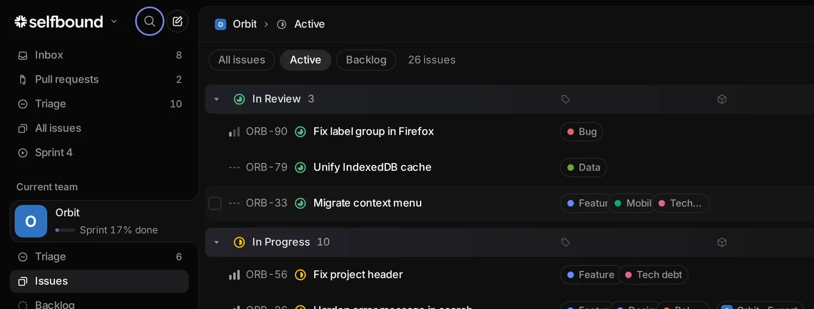

### D2: The context menu is taller than a laptop window and cannot scroll
Impact high · effort S · friction

- **Where:** right click on a row or card. `app.css:2277` (`.context-menu`), `app/src/lib/ui.ts:42`
  (`keepInView`).
- **Problem:** 25 entries are 863 px. The menu has no `max-height`. At 720 px window height "Repeat",
  "Public on the roadmap", "Select" and "Delete" cannot be reached. Because it never fits below the pointer
  it is always pinned to the top: a right click at y = 732 opens a menu whose first entry is 690 px away.
- **Fix:** `max-height: calc(100dvh - 16px); overflow-y: auto; overscroll-behavior: contain;` and
  `keepInView` clamps the position instead of jumping to the top.

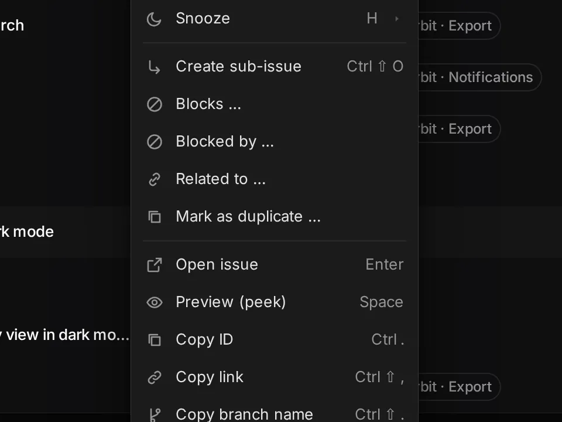

### D3: German shows Backspace as "Entf", the Delete key
Impact high · effort S · text

- **Where:** `core/src/locales/de.ts:117` (`Backspace: 'Entf'`, next to `Del: 'Entf'`).
- **Problem:** every Backspace shortcut names the wrong key. The help reads "Löschen · Strg Entf / Strg
  Entf", the inbox hint "Entf entfernen".
- **Fix:** `⌫` in both languages, as the Mac branch already does.

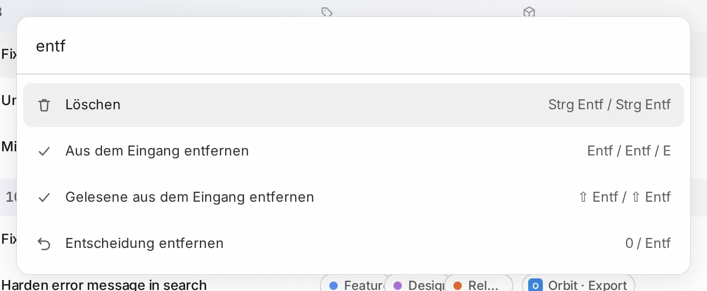

### D4: Search says "No results" while the full-text search is still running
Impact medium · effort S · friction

- **Where:** `/`. `core/src/app/palette.ts:1134-1175` (160 ms debounce), `Palette.svelte:131`.
- **Problem:** a word that occurs only in descriptions shows "No results" from 106 ms to 653 ms, then 20
  hits replace it.
- **Fix:** while the server search is pending and nothing matched locally, the text reads "Searching
  descriptions and comments …" / "Suche in Beschreibungen und Kommentaren …". "No results" comes only after
  the server answered.

### D5: The command menu and the search jump 250 px sideways
Impact medium · effort S · visual

- **Where:** `Palette.svelte:64` (`left: calc(50% - 250px)` when the peek is shown).
- **Problem:** the palette is centered and snaps 250 px left as soon as the active row is an issue with a
  preview, and back when it is not. In the search it goes centre, left, centre within one query. The first
  full-text hit has no preview until an arrow key is pressed.
- **Fix:** decide once per opening. The search sits left whenever the window has room for palette and peek.
  The command menu stays left once it moved, with a `left` transition. The preview updates after the server
  hits are merged.

### D6: Command menu ranking: a field name plus Enter sets the first value
Impact medium · effort S · friction

- **Where:** `rank()` in `core/src/app/palette.ts:1235`, `scoreText()` in `core/src/search.ts:132`.
- **Problem:** "stat" plus Enter sets the issue to Triage, because "Status: Triage" ranks above "Change
  status …". "prio" plus Enter sets "No priority". German "verschieben" lists "Zurückstellen …" first.
  "board" finds "Show keyboard shortcuts".
- **Fix:** label hits score above keyword hits above detail hits, keywords match only at a word start, and a
  query that matches only the field prefix ranks the picker command first.

### D7: Values in the command menu do not show the current state
Impact medium · effort S · friction

- **Where:** `core/src/app/palette.ts:902-911`, `Palette.svelte:111`.
- **Problem:** with a Low, Bug issue focused, "prio" lists five priorities without a mark on Low, and "Label:
  Bug" gives no sign that it is set. Enter removes it.
- **Fix:** keep `checked` on these rows and draw the check at the right end. A label every target has reads
  "Remove label: Bug" / "Label entfernen: Bug".

### D8: The help overlay is a nine-screen list
Impact medium · effort M · visual

- **Where:** `?`. `app.css:2094-2128`, `#helpItems()` in `palette.ts:922`.
- **Problem:** 77 rows of 46 px in a 420 px window. The section "General" appears twice. Rows without an
  icon start 28 px further left.
- **Fix:** for the help only: 30 px rows without icons, two columns on wide windows, 880 px wide, 76vh high,
  items sorted so each section appears once.

### D9: Help: searching for a key finds nothing, entries are missing or doubled
Impact medium · effort S · text

- **Where:** `#helpItems()`, `rank()`, `core/src/keyboard.ts:50`.
- **Problem:** the placeholder says "Search shortcut or action …", but "ctrl" gives "No results". "Mark as
  read · U" and "Mark as unread · U" are two rows. Triage key 2 is hidden. Home, End, the digits in pickers
  and Tab and Backspace inside pickers are listed nowhere. "TAB" is upper case.
- **Fix:** the shortcut text counts in the help search. One row "Mark as read / unread". Key 2 shows in the
  help. A fixed section "In menus and pickers" / "In Menüs und Auswahllisten". `tab: 'Tab'`.

### D10: Due date and snooze do not understand "next friday"
Impact medium · effort S · friction

- **Where:** `parseDueInput()` in `core/src/format.ts:253`, placeholder in `palette.ts:69`.
- **Problem:** of about 55 inputs these fail: "next friday", "nächsten freitag", "am freitag", "next month",
  "in 1 monat", "wochenende", "12/10", a bare day number. "none", "clear" and "ohne" do not find "No due
  date". A bare "3" matches "End of week" through the day in its detail text. The English placeholder shows
  a German date, "12.10.".
- **Fix:** strip a leading "next / this / on / nächste(n) / kommende(n) / am" before the weekday test, add
  the month forms, give the "No …" rows the keywords `none clear remove kein ohne entfernen`, keep the
  detail out of the ranking, and use "e.g. tomorrow, fri, +3, Oct 12 …" in English.

### D11: Two-key sequences give no feedback, and a late second key runs on its own
Impact medium · effort M · friction · Decision

- **Where:** `core/src/app/keys.ts:7` (`SEQUENCE_MS = 1200`), `:125`.
- **Problem:** after G or O nothing changes on screen. A second key that comes late or belongs to no
  sequence runs as a single key: G, pause, S opens the status picker; G C opens the create dialog.
- **Fix:** after about 250 ms a small chip at the bottom centre shows "G …" and the continuations. Inside the
  window a second key that completes nothing is swallowed, Esc cancels. The chip lives in the overlays
  chunk.

### D12: Create dialog: the pickers advertise keys that do not work there
Impact medium · effort S for the hint, M for keys · friction · Decision for the keys

- **Where:** `CreateDialog.svelte:74-124`, `core/src/app/keys.ts:69`, `Palette.svelte:23`.
- **Problem:** each picker opened from a chip shows a key cap "P", "L" or "⇧D", but none of these keys works
  while the dialog is open. It also shows a chip "New issue", repeating the dialog title right above it.
- **Fix:** hide key cap and target chip when the target is the draft. With a yes, Alt S, P, L, D, E and T
  open the pickers in the dialog, which brings title plus priority plus label from 14 keys to 10.

### D13: Move to team: no confirmation without a loss, undo gives a third identifier, toasts are doubled
Impact medium · effort M · friction · Decision for the confirmation

- **Where:** `requestMove()` in `palette.ts:307`, toast in `core/src/app/list.ts:612`.
- **Problem:** Ctrl Shift M, team, Enter moves at once and the issue gets a new number. Undo moves it back
  with another new number: KEYS-2, QB-9, then KEYS-6. One move raises two toasts, the second with the
  placeholder "QB-…", and it stays after the undo. When something is lost, the confirmation lists it below
  the buttons in small muted text, and typing a letter filters both buttons away.
- **Fix:** one toast "KEYS-6 is now QB-10 · Undo"; no "no longer in this view" toast for moves; a toast
  closes when its entry is undone. In the confirmation the consequences stand above the buttons in normal
  text and the field is hidden. With a yes, the confirmation appears for every move, with the line "New ID
  in NOVA, ORB-66 stays valid as a link".

### D14: Filter: no way to clear from the picker, and a typed value closes it although it shows a checkbox
Impact medium · effort S · friction · Decision

- **Where:** `#filterTop()` and `#filterValues()` in `palette.ts:947`, `filter.clear` in `actions.ts:342`.
- **Problem:** clearing by keyboard is Ctrl K, "clear", Enter. Values typed at the first level show a
  checkbox, but Enter closes the picker, while the same row one level down toggles and stays. Digits do not
  work in the priority level.
- **Fix:** a last row "Clear filters" / "Filter zurücksetzen" in the picker when filters are set, which is
  not a decision. With a yes: Shift F clears, and a typed value toggles and stays like one level down.

### D15: Several shortcuts do nothing and do not say why
Impact medium · effort S · friction

- **Where:** `when` conditions in `actions.ts` (`manualOrder`, `someSnoozed`, `snoozable`, `boardView`,
  `group.toggle`), `#runFirst` in `keys.ts:142`.
- **Problem:** Alt ↓ on a grouped list, Shift H on an issue that is not snoozed and T on an ungrouped list
  are silent. Redo with nothing to redo does answer, so the pattern exists.
- **Fix:** an optional `why` on an action that `#runFirst` shows as a toast: "Reordering needs manual order
  without grouping", "Not snoozed", "Closed issues cannot be snoozed", "This view has no board", each with
  its German entry.

### D16: "Open in split view" never appears in the context menu
Impact medium · effort S · friction

- **Where:** `core/src/app/actions.ts:158`, `core/src/app/menu.ts:24`.
- **Problem:** the entry's `when` reads the menu state, but `open()` evaluates `when` before it sets the
  state. The entry is documented and never shown.
- **Fix:** `open()` sets the targets first and the action tests them. An e2e check covers it.

### D17: Submenus open in the wrong place and use a different row height
Impact medium · effort S · visual

- **Where:** `core/src/app/menu.ts:85`, `ContextMenu.svelte:16`, `app.css:2129`.
- **Problem:** with the keyboard the submenu opens relative to the click position, not to the menu after it
  was moved into view: the status submenu appears beside "Due date". At the right edge it assumes 220 px of
  width and leaves a 52 px gap. Submenu rows are 44 px, main rows 32 px.
- **Fix:** position from the measured item and the measured submenu width, and add `.submenu .menu-item` to
  the 32 px rule.

### D18: A submenu is lost when the pointer moves to it diagonally
Impact medium · effort S · friction

- **Where:** `ContextMenu.svelte:35`.
- **Problem:** every `pointermove` over another entry switches the submenu at once. Moving from "Change
  status" to the sixth status crosses the entries below and ends in the model list.
- **Fix:** while a submenu is open, a new parent takes over only after the pointer rested on it for 120 ms.

### D19: Context menu content: 25 entries and uneven wording
Impact medium · effort S for wording, M for regrouping · text · Decision for the regrouping

- **Where:** `core/src/app/actions.ts:151-193`, `core/src/locales/de.ts:151`.
- **Problem:** "Public on the roadmap: on/off" is the only entry with a colon and also shows in teams
  without a roadmap. "Preview (peek)" explains itself in brackets. "Repeat" opens a flat submenu of 35
  entries.
- **Fix:** "Toggle public on the roadmap" / "Öffentlich auf der Roadmap ein/aus", only with a roadmap.
  "Preview" / "Vorschau". With a yes: "Relation ▸" for the four relation entries and "Copy ▸" for the three
  copy entries, which leaves 20.

### D20: Ctrl K is dead in plain text fields
Impact low · effort S · friction

- **Where:** `core/src/app/keys.ts:83-93`.
- **Problem:** with the cursor in the issue title or the comment field Ctrl K does nothing. In the rich
  editor it inserts a link, which stays.
- **Fix:** let `mod+k` through when the target is an `input` or `textarea`.

### D21: The key hint in anchored pickers is hand-written
Impact low · effort S · visual

- **Where:** `PICKER_KEY` in `Palette.svelte:23`.
- **Problem:** the hint reads "⇧D" without a space while menus and help write "⇧ D". Snooze, parent and team
  have none. It would not follow "Strg".
- **Fix:** derive it with `formatShortcut(shortcutOf(…))` from the action.

### D22: On the issue page the same picker opens in the middle by key and at the property by click
Impact low · effort S · visual · Decision

- **Where:** `picker()` in `actions.ts:68`, `Properties.svelte`.
- **Problem:** S opens a 640 px picker over the description while the status row is at the right edge. A
  click on that row opens a 260 px picker right below it.
- **Fix:** on the issue page and in the split view the key variant uses the property row as its anchor when
  the row is on screen.

### D23: Pickers highlight the empty value, so Enter does nothing
Impact low · effort S · friction · Decision

- **Where:** `open()` in `palette.ts:153`.
- **Problem:** an issue without a sprint opens the sprint picker on "No sprint". Enter changes nothing.
- **Fix:** when the checked row is the empty one, highlight the first real choice: the active sprint,
  "Today", the first project.

### D24: Due date and estimate show the same result two or three times
Impact low · effort S · visual

- **Where:** `setQuery()` in `palette.ts:227`.
- **Problem:** "fri" shows the row "Fri, Nov 13", the row "End of week · Fri, Nov 13" and the hint line "fri
  → Fri, Nov 13". The code means to drop the duplicate, but the ids never match.
- **Fix:** compare the value instead of the id, and drop the hint line for parsed dates.

### D25: "No results" where nothing was searched or where a reason exists
Impact low · effort S · text

- **Where:** `Palette.svelte:131`, `palette.ts:1040`, `:233`.
- **Problem:** `/` without recently opened issues shows "No results" before a letter is typed. "today" in the
  snooze picker gives "No results". On a phone the search field is not focused, so the first tap on
  "Search" shows this text and typing goes nowhere.
- **Fix:** "Type to search issues and knowledge pages" / "Tippen, um Issues und Wissensseiten zu suchen";
  "Snooze needs a day after today" / "Zurückstellen braucht einen Tag nach heute"; "No date recognized. Try
  fri, +3 or Oct 12." / "Kein Datum erkannt. Zum Beispiel fr, +3 oder 12.10.". The search focuses its field
  on touch too.

### D26: The command menu's start list needs two screens for 14 commands
Impact low · effort S · visual

- **Where:** `#commandTop()` in `palette.ts:876`, `app.css:2103`.
- **Problem:** 14 rows plus 6 section headers are 832 px in a 420 px window. Three sections hold one row.
  "Undo" is below the fold.
- **Fix:** no section headers in the start list and `max-height: min(560px, 62vh)` for the centered palette.

### D27: The context menu can snooze to any date but set a due date only from five presets
Impact low · effort S · friction

- **Where:** `pickerItems()` in `palette.ts:743`.
- **Fix:** "Pick a date …" in the due submenu, as snooze has it.

### D28: Small visual points in menus
Impact low · effort S · visual

- **Where and fix:** the two toggles in the first filter level start 26 px further right than the property
  rows, so reserve the check slot on all rows. "Set priority …" uses the bars icon. A context submenu opened
  with → starts on the checked row, as the picker does.

---

## E. Inbox, triage, sprint, pull requests and sidebar

### E1: Inbox rows give the title half of the row
Impact high · effort S · visual

- **Where:** `/inbox`, split view at the default 420 px and on a phone. `InboxRow.svelte:32-51`,
  `app.css:1694-1793`.
- **Problem:** the row is 404 px wide and the title gets 147 to 216 px, about 23 characters. On a phone it
  gets 117 px. The age text ("10 months ago") takes up to 84 px. The remove button is invisible on 13 of 14
  rows and still reserves 34 px. Line 2 ends with the team name, which the avatar badge and the identifier
  already show. The unread dot shifts the identifier by 13 px.
- **Fix:** the remove button sits in the status icon's slot on hover and focus. The age is short ("5 min",
  "3 h", "2 d", "1 mo" / "5 Min.", "3 Std.", "2 T.", "1 Mon.") with the full date as tooltip. Line 2 drops the
  team. The dot moves to the row's left edge. The title then gets about 290 px.

### E2: The inbox opens with the right side empty, and the first J skips the first entry
Impact high · effort S · friction · Decision

- **Where:** `core/src/app/actions.ts:141` (`step`), `core/src/app/detail.ts:211`, hint in
  `SplitView.svelte:129`.
- **Problem:** the first row is focused but the right side says "Pick an entry on the left". J moves to the
  second entry and shows that one. The newest entry only shows with Space, which the hint does not mention.
- **Fix:** while the focus is still the automatic one and the right side is closed, J or ↓ shows the focused
  entry instead of moving.

### E3: After triage the toast says "no longer in this view" instead of what happened
Impact high · effort S · text

- **Where:** `/triage`, keys 1 and 3. `core/src/app/list.ts:612`, `palette.ts:845`, `actions.ts:207`.
- **Problem:** accept and decline both end in "ORB-73 is no longer in this view · Undo".
- **Fix:** "ORB-73 accepted as Backlog", "ORB-73 accepted into Nova", "ORB-73 declined", "3 issues declined"
  / "ORB-73 als Backlog angenommen", "ORB-73 in Nova angenommen", "ORB-73 abgelehnt", "3 Issues abgelehnt".

### E4: The empty inbox shows two empty states side by side
Impact medium · effort S · visual

- **Where:** `SplitView.svelte:125`, `ListPage.svelte:41`.
- **Problem:** left an icon with three lines, right the same icon with "All done. New entries appear on the
  left.", 23 px apart vertically. This is the state every inbox session ends in.
- **Fix:** with zero entries the inbox does not split. One text: "All done. New entries from agents and
  returning snoozed issues appear here." / "Alles erledigt. Neues von Agenten und zurückgestellte Issues, die
  zurückkommen, erscheinen hier."

### E5: "Settings" appears twice in the sidebar with the same icon and label
Impact medium · effort S · text

- **Where:** `Sidebar.svelte:236` (team), `:277` (app).
- **Fix:** the team entry reads "Team settings" / "Team-Einstellungen" and carries the team icon.

### E6: Triage actions are offered for inbox entries that are not in triage
Impact medium · effort S · friction · Decision

- **Where:** `core/src/app/actions.ts:62` (`inTriage` = triage view or inbox).
- **Problem:** the context menu of a Todo entry in the inbox starts with "Accept … 1" and "Decline 3". Key 3
  would cancel an accepted issue.
- **Fix:** in the inbox the triage actions require that every target is in triage.

### E7: Sprint close: counts and key hints look the same, "Cancel" reads like "abort"
Impact medium · effort M · text

- **Where:** `ClosePage.svelte:69-96`, `.kbd` in `app.css:1943`.
- **Problem:** the stats "Next sprint 1 · Backlog 1 · Cancel 1" are counts, the buttons below "Next sprint 1
  · Backlog 2 · Cancel 3" are keys, and the key cap border is invisible on a button. "Cancel" next to "Close
  Sprint 4" reads as "abort closing". A decided row gets a chip that pushes its labels 92 px left. Decisions
  are lost on reload.
- **Fix:** counts move into the buttons, key first: `[1] Next sprint · 4`. `.btn .kbd` gets a visible edge.
  "Cancel issue" / "Issue abbrechen". Every row reserves the chip slot. Decisions and the retrospective draft
  live in `sessionStorage` per sprint.

### E8: Sprint header: labels 10 px off, three numbers need decoding
Impact medium · effort S · visual

- **Where:** `SprintHeader.svelte:37-58`, `sprint.css:86`.
- **Problem:** "Progress" sits 10 px above the other stat labels. "Added late: 5 · 21 %" does not say of
  what. "22 points · 182 % planned" must be combined with a number in another cell. "ended 23 days ago" is
  muted although the sprint still runs.
- **Fix:** `align-items: flex-start`. "5 of 24 issues" / "5 von 24 Issues". "40 of 22 points planned" / "40
  von 22 Punkten verplant" in the warning colour when over. A passed end date shows in the warning colour.

### E9: The sidebar scrolls without any hint
Impact medium · effort S · visual

- **Where:** `.nav-scroll` in `app.css:445` (`scrollbar-width: none`).
- **Problem:** at 900 px height with twelve teams the "Inactive" section is below the fold, with no
  scrollbar and no fade. A card is cut in half above "Trash".
- **Fix:** a sticky 28 px fade at the bottom of the scroll area, in CSS only.

### E10: Planning: name, dates, goal and capacity need the mouse
Impact medium · effort M · friction

- **Where:** `core/src/app/sprints.ts:471`, `PlanPage.svelte:114`, `:175`.
- **Problem:** Tab switches the column, so no field can be reached by keyboard. The arrows in the key row
  are half the size of "Tab". The suggested capacity appears three times.
- **Fix:** commands "Edit sprint goal" and "Set capacity" in the sprint chunk. Larger arrow caps. One link
  "Use 14.7" / "14,7 übernehmen".

### E11: "Edit sprint": the pencil floats beside the goal, the form takes no focus, Esc does not close it
Impact medium · effort S · friction

- **Where:** `SprintHeader.svelte:22-36`, `actions.ts:264`.
- **Problem:** the pencil sits at the end of the goal and reads as "edit goal", but opens the form for name,
  dates and capacity. The goal itself is edited by a click on the text, with no hover cue.
- **Fix:** the pencil moves into the location bar as "Edit" / "Bearbeiten". The form focuses the name and
  closes on Esc. The goal gets a hover underline.

### E12: The sprints overview says the state twice and uses three words for it
Impact low · effort S · text

- **Where:** `SprintsPage.svelte:13`, `core/src/sprintlogic.ts:53`, `palette.ts:1229`.
- **Problem:** closed rows show the badge "Finished" and "completed" in the date column. The running sprint
  is "Running" in the badge and "active" in the picker. A sprint in planning shows "0 · 0 %".
- **Fix:** Running, Planned, Closed / Läuft, Geplant, Abgeschlossen everywhere. The date column shows only
  what the badge does not say. "–" in planning.

### E13: The logo button looks like a workspace menu and opens the command menu
Impact low · effort S · friction

- **Where:** `Sidebar.svelte:156`.
- **Fix:** no chevron, tooltip "Command menu" with its shortcut.

### E14: Pull requests: no row focused on arrival, the PR page has no way back
Impact low · effort S · friction

- **Where:** `core/src/app/pulls.ts:30`, `core/src/app/index.ts:631`, `PullRequestView.svelte:173`.
- **Problem:** `/pulls` starts without a focus, so Enter does nothing until J. From a PR beside the list,
  Enter goes full size and Esc returns with the PR closed. The PR page's crumbs are plain text.
- **Fix:** focus the first open PR. Restore the open PR on the way back. Crumbs "Pull requests › orbit-app
  #128" with a link.

### E15: A link in the PR notice does not look like one
Impact low · effort S · visual

- **Where:** `.pr-notice` in `pr.css:288`.
- **Fix:** `.pr-notice a { color: var(--accent-text); }`. The faint texts of this page are in A10.

### E16: "Open full size" uses two different icons
Impact low · effort S · visual

- **Where:** `IssuePage.svelte:77`, `PullRequestView.svelte:183`.
- **Fix:** `ICON.expand` for "Open as a page" in both places. `ICON.open` stays for links that leave the app.

### E17: Projects and sprints pages cannot be used with J/K and Enter
Impact low · effort M · friction

- **Where:** `ProjectsPage.svelte:57`, `SprintsPage.svelte:39`.
- **Problem:** J, K and Enter do nothing on both card lists. No "Go to: Projects" command exists. A
  project's crumbs lack a "Projects" level. The empty state says "Create projects in the settings" and its
  button is "Go to issues".
- **Fix:** a shared card-list key handler, `go.projects` in the command menu, crumbs "Orbit › Projects ›
  Export", empty state button "Create project" / "Projekt anlegen".

### E18: Empty states: "Create issue" under "Nothing is snoozed", two vertical positions
Impact low · effort S · visual

- **Where:** `Empty.svelte:15`, `.page-content` in `app.css:2500`.
- **Fix:** no create button on the Snoozed view. Page empty states are centred like list ones.

### E19: The triage keys are not shown where triage happens
Impact low · effort S · friction · Decision

- **Where:** `core/src/app/actions.ts:196-212`.
- **Problem:** the inbox and planning show their keys on screen, triage shows none. Key 2 is hidden in help
  and context menu. The accept picker repeats "Accept into …" seven times.
- **Fix:** key 2 shows in help and context menu, picker entries are just the team name. With a yes, a key
  row like in planning: `1 accept · 2 duplicate · 3 decline · H snooze`.

---

## F. Knowledge, roadmap, settings and missing pages

### F1: Roadmap cards render twice
Impact high · effort S · visual

- **Where:** `/team/EMB/roadmap`. `core/src/app/roadmap.ts:157-163`, `ReleaseView.svelte:72`.
- **Problem:** the columns paint from cached issues before `roadmap.cards` has answered. Cards first show
  the internal title, about 60 px tall, then swap to the public title, a 16:9 picture and the summary, up to
  295 px. Layout shift 0.248 on a cold start and on a revisit. Offline the first state stays. The flag
  `ui.loaded` exists and nothing reads it.
- **Fix:** card lists render once `ui.loaded` is true, with two placeholder cards per column until then. The
  last cards map survives revisits of the same team.

### F2: Progress bars: label unreadable in light, completion dots sit on the label
Impact medium · effort S · visual

- **Where:** `roadmap.css:618-648`, `ProgressView.svelte:147`.
- **Problem:** "2 of 10 done" is near-white on a bar mixed with the panel colour: 2.06 to 2.24 : 1 in light.
  Completion dots cover the label's first digit. The legend swatch "worked on" is always indigo while the
  bars use the project colour.
- **Fix:** the label sits right of the bar in muted text. The legend swatch is neutral grey.

### F3: Roadmap filter row: "Clear filters" and the hidden count are cut off
Impact medium · effort S · visual · Decision for the header numbers

- **Where:** `roadmap.css:43` (`.rm-filters`: `overflow-x: auto; scrollbar-width: none`).
- **Problem:** with six categories and five stages the row is 1347 px in a 1188 px box. "Clear filters" is
  clipped and the row scrolls without a scrollbar. With a stage filter the column header counts the
  filtered set ("2 of 2 done", full bar).
- **Fix:** the row wraps, with "Clear filters" and the note pinned right. With a yes, the header keeps the
  unfiltered numbers.

### F4: Settings have no "back" key
Impact medium · effort S · friction · Decision

- **Where:** `core/src/app/keys.ts:98`, `SettingsNav.svelte:26`.
- **Problem:** Esc leaves an issue page but not the settings. The list one came from, with its filters, is
  reachable only by a click on "Back to app".
- **Fix:** Esc on a settings page without an open dialog or focused field calls `nav.toLastView()`. The
  button shows the key.

### F5: The knowledge tree cannot be walked with the keyboard
Impact medium · effort M · friction · Decision

- **Where:** `WikiTree.svelte:62-71` handles only → and ←.
- **Problem:** the tree has `role="tree"` but ↓, ↑, J and K do nothing. Every row, caret and plus button is
  its own Tab stop.
- **Fix:** ↓/J and ↑/K move between rows, Home and End jump, the tree is one Tab stop, rows get a focus
  ring.

### F6: Most knowledge actions are missing from the command menu
Impact medium · effort S · friction

- **Where:** `core/src/app/actions.ts:245`, buttons in `WikiPage.svelte:115`.
- **Problem:** "New page", "Move page to trash", "Copy page link", "Revisions" and "Deleted pages" exist
  only as header buttons. `AGENTS.md` asks for a command menu entry for every action.
- **Fix:** five actions registered in the wiki chunk, as the roadmap does it, so the start bundle does not
  grow. Shortcuts would be a decision.

### F7: Topic picker: Enter on a partial match creates a new topic
Impact medium · effort M · friction

- **Where:** `ArticleProps.svelte:69-76`. No caller of `api.wiki.updateTopic`.
- **Problem:** typing "Ho" shows "Howto" and below it "Create topic "Ho"". Enter creates. Arrow keys do not
  move. A topic made by accident stays, the app cannot rename or archive topics.
- **Fix:** a highlighted row, first match by default, ↓/↑ move it, Enter toggles it. "Create topic" is last.
  Rename and archive per row would be new functions and need a yes.

### F8: New page: after naming it the focus falls to nowhere
Impact medium · effort S · friction · Decision

- **Where:** `WikiPage.svelte:50-62`, `:193`.
- **Problem:** Enter in the title only blurs it. Writing a page is: click, type title, Enter, E, type.
- **Fix:** for a fresh page Enter in the title saves it and starts the text editor.

### F9: Stage colours differ between the roadmap and its export
Impact medium · effort S · visual · Decision

- **Where:** `roadmap.css:107-121` against `exportImage.ts:48`.
- **Problem:** in the app "Done" is indigo and "Testing" green. In the exported image "Done" is green and
  "Testing" violet. The preview stands beside the page.
- **Fix:** one mapping for both. Which one is the owner's call.

### F10: Yes/no settings use three different controls
Impact medium · effort S · visual

- **Where:** On/Off segments in `General.svelte:86` and `Notifications.svelte:101`; switches in
  `TeamDetail`, `Workflow`, `TeamRoadmap`, `Labels`; checkboxes in `Labels.svelte:53` and `Workflow.svelte:96`.
- **Problem:** the On/Off pair is the hardest to read: the chosen half differs from the track by 1.28 : 1.
  Nine of them stand in a column under Notifications.
- **Fix:** the switch for every stored yes/no. Segments stay for real choices, checkboxes for view filters.

### F11: Reordering looks different in every list, arrows at the ends look active
Impact medium · effort S · visual

- **Where:** `Teams.svelte:71`, `Projects.svelte:82`, `Workflow.svelte:113`, `ArticleSources.svelte:95`.
- **Problem:** five lists with different icons and positions for "move up/down". In the workflow the two
  buttons are 28 × 12 px each. Disabled arrows are not dimmed.
- **Fix:** chevrons side by side at the right end, always visible, 24 px targets. The `.icon-btn:disabled`
  rule from A1 dims the ends.

### F12: Editable names look like plain text; a wrong team key is answered far away
Impact medium · effort S · visual

- **Where:** `/settings/teams/ORB`. `settings.css:136` (`.inline-text`), `TeamDetail.svelte:77`.
- **Problem:** "Orbit" and "ORB" stand as bare text, only hovering reveals a field. The profile name is a
  boxed input. A wrong key is answered by a toast 600 px from the field, and the field jumps back.
- **Fix:** `.inline-text` in card rows has the input look at rest. The key problem shows as `.field-error`
  under the field, which keeps the typed value and the focus.

### F13: "General" contradicts itself and repeats each heading as a row label
Impact low · effort S · text

- **Where:** `General.svelte:42-90`.
- **Problem:** the lead says "Settings for this device. They take effect right away, without reloading."
  Two rows below say the language reloads the page and the time zone applies to the whole instance. Three
  sections are a heading and one row with the same word.
- **Fix:** lead "Language, sidebar and sounds apply to this device. The time zone applies to the whole
  instance. Color scheme, themes and fonts are under Appearance." / "Sprache, Seitenleiste und Töne gelten
  für dieses Gerät. Die Zeitzone gilt für die ganze Instanz. Farbschema, Themes und Schriften stehen unter
  Darstellung." Two cards, "This device" and "Instance", without repeated headings.

### F14: Knowledge header: two trash icons and three words for the trash
Impact low · effort S · text · Decision for moving the button

- **Where:** `WikiPage.svelte:115-122`, `core/src/app/wiki.ts:483`.
- **Problem:** a trash can with "Deleted" opens the list of deleted pages, a bare trash can two icons on
  deletes this page. The list is "Deleted", "Deleted pages" and "trash". English toasts say "Version" where
  the UI says "Revisions".
- **Fix:** "Trash" / "Papierkorb" for button and heading. "Revision restored. The previous text is now under
  Revisions." With a yes, the trash button moves to the foot of the tree.

### F15: Three looks for a dropdown; a project chip that offers nothing
Impact low · effort S · visual

- **Where:** bare native `select` in `WikiTree.svelte:29`, `ArticleProps.svelte:42`, `Appearance.svelte:171`
  against `.dp-select` everywhere else.
- **Fix:** wrap the four selects in `.dp-select`. Hide the project chip on a team without projects.

### F16: Unknown team or page: different answers, two of them a loading state that never ends
Impact low · effort S · friction

- **Where:** `/team/NOPE`, `/team/NOPE/wiki`, `/wiki/unknown`. `core/src/app/wiki.ts:231`.
- **Problem:** `/team/NOPE` shows an ordinary empty list with "Create issue". `/team/NOPE/wiki` shows two
  skeleton bars forever. `/wiki/unknown` says the page does not exist, keeps the skeleton and offers no
  button.
- **Fix:** one state for all team pages, "Team {key} does not exist." with a button "Go to inbox". The wiki
  sets its rows to empty once the metadata is loaded and no team matches.

### F17: Confirmation dialogs take three keys to confirm
Impact low · effort S · friction · Decision

- **Where:** `pages/settings/Dialog.svelte:28` focuses the dialog box itself.
- **Fix:** focus the confirm button for harmless confirmations and "Cancel" for the red ones.

### F18: Two different ways to create a team
Impact low · effort S · friction · Decision

- **Where:** `Teams.svelte:53` (inline form: name, key) against `NewTeamDialog.svelte`.
- **Problem:** the settings form lacks logo and "Knowledge only". The small add forms also differ in their
  buttons and in whether they take the focus.
- **Fix:** every inline add form gets "Cancel" and "Create" and focuses its first field. With a yes, "New
  team" in the settings opens the dialog.

### F19: The profile's upload button is not at the row's end
Impact low · effort S · visual

- **Where:** `Profile.svelte:60`. The upload icon is in A11.
- **Fix:** `.who { flex: 1; }`.

### F20: Spacing slips: revisions panel, "Custom themes" heading, export options
Impact low · effort S · visual

- **Where:** `wiki.css:28`, `Appearance.svelte:137`, `ExportDialog.svelte:179`.
- **Problem:** 32 px above the revisions title and 12 px below its content. 56 px above "Custom themes"
  where other headings have 28. The export dialog's segments stretch to 283 px with a dead grey track.
- **Fix:** `.wiki-revisions .section-title { margin-top: 8px; }`, the inline heading class with a spacer,
  `align-self: flex-start` on the segments.

### F21: The reason for a disabled "Archive" cannot be seen
Impact low · effort S · friction

- **Where:** `Workflow.svelte:129`, `forms.css:39` (`.btn:disabled { pointer-events: none }`).
- **Problem:** the button has the title "The last status of this type is required", but without pointer
  events the tooltip never appears.
- **Fix:** disabled buttons keep pointer events and get `cursor: default`.

### F22: Sources show raw ISO dates
Impact low · effort S · text

- **Where:** `ArticleSources.svelte:54`: "accessed 2026-11-10".
- **Fix:** `toLocaleDateString(intlLocale(), { dateStyle: 'medium' })` for full dates.

### F23: "Roadmap › Roadmap | Progress"
Impact low · effort S · text

- **Where:** `RoadmapPage.svelte:50`.
- **Problem:** the breadcrumb ends in "Roadmap" and the first tab is "Roadmap" again.
- **Fix:** the tab is "Stages" / "Etappen", matching the command "Roadmap: Etappen".

### F24: Consent page without a request: unclear sentence, off-centre
Impact low · effort S · text

- **Where:** `OAuthConsent.svelte:35`, `:127`.
- **Fix:** centre the text. "This link is incomplete. Start the connection again in Claude or ChatGPT." /
  "Dieser Link ist unvollständig. Starte die Verbindung in Claude oder ChatGPT neu."

---

## G. Phone and window widths

No route overflows the page horizontally: 34 routes at 390 and 360 px, 16 routes at nine desktop widths,
also with font size "Large". The scroll position survives opening an issue and going back. G5, G11 and G20
rest on the code and on measured sizes, because headless Chromium has no on-screen keyboard, no iOS focus
zoom and no safe areas. They need a check on the device.

### G1: Sprint close on a phone: the submit button lies under the bottom bar
Impact high · effort S · friction

- **Where:** `/sprint/close` at 390. `sprint.css:323` (`.close-foot`), bar at `app.css:2801`.
- **Problem:** of "Close sprint" 10 px stay visible between the tab bar and the create button. The hint "20
  still without a decision" is hidden completely.
- **Fix:** `.close-foot { padding-bottom: calc(84px + env(safe-area-inset-bottom)); }` in the phone block.

### G2: Settings on a phone: rows with a control do not wrap
Impact high · effort S · visual

- **Where:** `settings.css:438`. The phone block has no rule for `.card-row`.
- **Problem:** the control keeps its width and the text gets the rest. "Time zone": text 65 px wide and 435
  px tall. Label names are 47 px wide ("Featu"). Both projects of a team read the same.
- **Fix:** `.card-row { flex-wrap: wrap; row-gap: 8px; }` and `.card-row > .t { flex: 1 1 180px; min-width:
  0; }`. Label and project names take the first line.

### G3: Issue page between 769 and about 1000 px: the text column is 137 to 268 px wide
Impact high · effort S · visual

- **Where:** `detail.css:20`, `:361` (`.props-col` fixed 300 px), `:535` (the rule that moves properties
  above the text exists only for `.split-detail`).
- **Problem:** at 769 px the text column is 137 px, about 20 characters per line. At 900 px it is 268 px.
- **Fix:** the issue page becomes a container and applies the split view's narrow rules below 760 px of
  panel width.

### G4: Issue page on a phone: the header shows "Or… › ORB-…"
Impact high · effort S · visual

- **Where:** `IssuePage.svelte:48`, `detail.css:561` (the rules that keep the key whole exist only for
  `.split-detail`).
- **Fix:** on a phone the team crumb shows only its logo and the key crumb does not shrink.

### G5: Create dialog on a phone: chips and "Create issue" sit where the keyboard is
Impact high, to be confirmed on a device · effort M · friction

- **Where:** `app.css:2935`, `overlays.css:110`, `app/index.html:5`.
- **Problem:** the dialog is `height: 100%` and focuses the title, so the keyboard opens. Nothing reacts to
  it: no `visualViewport`, no `dvh`. Chips are 26 px tall, "Save as draft" 96 × 24 px. The placeholder says
  "images with Ctrl V".
- **Fix:** `interactive-widget=resizes-content` in the viewport meta, the dialog height from
  `visualViewport` in the overlays chunk, chips in one scrolling row at 32 px, safe-area padding in the
  footer.

### G6: "Search" in the phone bar opens the search without focus
Impact high · effort S · friction

- **Where:** `Palette.svelte:19`, `:88` (`{@attach !coarse && autofocus}`).
- **Problem:** on touch no palette focuses its field. That is right for pickers, but the search needs a
  second tap before typing.
- **Fix:** the search focuses its field on touch too.

### G7: Picker sheets on a phone: 32 px entries, labels sheet only 320 px wide
Impact medium to high · effort S · visual

- **Where:** `app.css:2028`, `:2129`, phone overrides `:2886`.
- **Problem:** three specificity misses. `.anchored .menu-item { height: 32px }` beats the phone's 46 px.
  `.palette.anchored.wide { width: 320px }` beats the phone's `width: auto`, so the labels sheet leaves 62
  px in which the page shows. Left margin 8 px, right margin 16 px.
- **Fix:** the phone block names the same selectors: full width, 46 px entries, `max-height: min(60dvh,
  460px)`.

### G8: Context menu on a phone: 25 entries and 19 keyboard shortcuts
Impact medium · effort S · visual

- **Where:** `ContextMenu.svelte:49`, `app.css:2905`.
- **Problem:** the sheet fills the screen and scrolls. Its head shows only "ORB-26". Every entry carries a
  keyboard shortcut, which the palette already hides on touch.
- **Fix:** no shortcuts on touch, head with key and title.

### G9: Board on a phone: the last card of every column ends under the bottom bar
Impact medium · effort S · visual

- **Where:** `board.css:69` (`.column-scroll`), phone block `:206`.
- **Fix:** `.column-scroll { padding-bottom: calc(84px + env(safe-area-inset-bottom)); }`.

### G10: Trash on a phone: the title keeps 48 px, "Wiederherstellen" is cut off
Impact medium · effort S · visual

- **Where:** `rowHtml.ts:115`, `app.css:1526`.
- **Problem:** at 360 px in German the title is 48 px wide and 27 px of the button are clipped.
- **Fix:** on a phone the row shows the age without the word "deleted" and the button is an icon button.

### G11: Text fields below 16 px on a phone
Impact medium to high on an iPhone, to be confirmed · effort S · friction

- **Where:** palette field in sheets 13 px, comment field 14, create description 15, sprint goal 14,
  retrospective 13, planning dates 12.
- **Problem:** Safari zooms the page when a field below 16 px gets the focus and leaves it zoomed.
- **Fix:** `@media (max-width: 768px) and (pointer: coarse) { input, textarea, select, .palette-input {
  font-size: 16px; } }`.

### G12: 768 and 769 px: a stretched phone list, then a cramped desktop
Impact medium · effort M · visual

- **Where:** `core/src/app/index.ts:253`, `ListView.svelte:46` (`MOBILE_PROPS`).
- **Problem:** at 768 px rows show four properties and the right half is empty. One pixel more gives a
  sidebar plus a 517 px list with nine properties and 11 of 23 titles truncated.
- **Fix:** what a row shows follows the list's width, not `mobile`. Row height and bar stay tied to `mobile`.

### G13: Sprint planning below about 1000 px and on a phone
Impact medium · effort M · visual

- **Where:** `sprint.css:406-452`.
- **Problem:** at 769 px two columns of 260 px show five characters of each title, nine team budgets stack
  into nine rows, and the filter buttons are drawn on top of "Sprint 5". On a phone the two lists show four
  and three rows.
- **Fix:** the columns stack by container width below 760 px, the budget strip scrolls sideways, the goal
  collapses to one line while planning.

### G14: Roadmap header: the crumbs shrink to 6 px
Impact medium · effort S for the header, M for the labels · visual

- **Where:** `RoadmapPage.svelte:46`, `roadmap.css:5`, `:798`.
- **Problem:** at 390 and 769 px the tab switch is painted over the crumbs. On the progress view the "Today"
  pill covers the quarter label.
- **Fix:** the crumbs do not shrink, and below 900 px of bar width only the logo shows. The "Today" label
  hides when it would overlap.

### G15: Issue page on a phone: the time of an activity entry wraps into three lines
Impact medium · effort S · visual

- **Where:** `Activity.svelte:107`, `:189`, `detail.css:176`.
- **Problem:** next to a two-line text the time becomes "· 2 / months / ago". The comment box shows "Ctrl
  Enter to send" on a phone.
- **Fix:** `.act-event .when { flex: none; white-space: nowrap; }`, no key hint on mobile.

### G16: View tabs on a phone are cut without a hint that they scroll
Impact medium · effort S · visual

- **Where:** `app.css:2738`.
- **Problem:** three tabs need 243 px and get 230 px at 390 and 200 px at 360, where German reads "Bac".
- **Fix:** 11 px tab padding on a phone and a fade mask at the right end when the strip scrolls.

### G17: Display options on a phone offer ten property chips that do nothing
Impact low to medium · effort S · friction

- **Where:** `ListView.svelte:46`, `DisplayPopover.svelte`.
- **Problem:** phone rows render only priority, status and due date, the popover still shows 13 chips.
- **Fix:** on a phone the list layout shows the three that apply and one muted line: "A phone list shows
  priority, status and due date." / "Am Handy zeigt die Liste Priorität, Status und Fälligkeit."

### G18: Outside list and issue page, controls keep their desktop size on a phone
Impact medium · effort M · friction

- **Where:** sprint planning and close (24 px tall buttons and fields), roadmap tabs and chips (26 px),
  settings switches, selects and small buttons (24 to 26 px), the "Show archived" checkbox (13 × 13 px),
  pull request chips (22 px).
- **Fix:** one phone block in the pattern of `app.css:2988`: 36 px minimum height for segments, chips and
  selects, invisible `::after` hit areas for small buttons and toggles.

### G19: Tables in texts on a phone: a column with a link collapses to four characters per line
Impact low to medium · effort S · visual

- **Where:** `md.css:818` (`.md td a { overflow-wrap: anywhere }`).
- **Fix:** `.md td:has(a), .md th:has(a) { min-width: min(18ch, 60cqw); }`.

### G20: Safe areas are honoured only by the bottom bar and the toasts
Impact medium on an installed iPhone app, to be confirmed · effort S · visual

- **Where:** `app/index.html:5` (`viewport-fit=cover`); `env(safe-area-inset-*)` only at `app.css:2806` and
  `:2972`.
- **Fix:** safe-area padding for the create footer, context menu, picker sheets, drawer and sprint close
  footer, and inline insets on the frame for landscape.

### G21: A phone held sideways gets the desktop layout
Impact low · effort S · friction

- **Where:** `core/src/app/index.ts:253`, `app.css:3151`.
- **Problem:** above 768 px the phone rules stop: 28 px nav items and 16 px status targets on a touch
  screen.
- **Fix:** the `pointer: coarse` rule for row cells applies without the width condition, nav items get 40 px
  on touch.

---

## H. Texts in English and German

### H1: German uses three words for the parent issue, and "von Du"
Impact medium · effort S · text

- **Where:** `core/src/locales/de.ts:82`, `:161`, `:265`, `:311`, `:440`; `locales/de/components.ts:93`,
  `:109`, `:344`.
- **Problem:** "Parent", "Eltern-Issue" and "übergeordnetes Issue" name one thing, sometimes on one screen.
  The meta line reads "Erstellt 10. Nov. von Du", English "Created Nov 10 by You".
- **Fix:** "Parent-Issue" throughout, the pair to "Sub-Issue". "Created {when} by you" / "Angelegt {when}
  von dir" for the owner.

### H2: Issues are "deleted", pages are "moved to trash"
Impact medium · effort S · text

- **Where:** `core/src/app/actions.ts:193` ("Delete", red); `WikiPage.svelte:122` ("Move to trash").
- **Problem:** the same reversible action has two names. "Delete" in red promises more than happens: the
  issue goes to the trash and the toast offers undo.
- **Fix:** "Move to trash" / "In den Papierkorb" for issues too. Label only, id and shortcut stay.

### H3: Mixed terms for one thing
Impact medium · effort M · text

| Thing | Now | Use |
|---|---|---|
| Pull request | "PR merged" next to "Pull request not updated"; German "PR" 6 times, "Pull Request" 15 times | "Pull request" / "Pull Request" in labels and toasts |
| Filters | "Reset filters" and "Clear filters" | "Clear filters" |
| Identifier | "ID" and "identifier" | "ID" in English, "Kennung" in German |
| Activity | "Activity" and "history"; "Aktivität" and "Verlauf" | "activity" / "Verlauf" |
| Selected | "{count} gewählt" and "{count} ausgewählt" | "ausgewählt" |
| Created | "Erstellt" in the meta line, "angelegt" in every action | "Angelegt" |
| Show | "zeigen" and "anzeigen" | "anzeigen" |
| Offline | "Offline", "Ohne Verbindung", "Keine Verbindung" | "Offline" for the state label |
| Team settings | "Einstellungen des Teams" and "Team-Einstellungen" | "Team-Einstellungen" |
| Workspace | "Arbeitsbereich" and "(Workspace)" | "Arbeitsbereich" |
| Roadmap stage | "Auf Test" | "Im Test" |
| Sprint state | "Current sprint", "active sprint", "is running" | "active" |

### H4: German progress texts use three grammatical forms
Impact low · effort S · text

- **Problem:** "Speichert …", "Wird angelegt …" and "Verbinde …" for the same kind of state.
- **Fix:** the passive, which is already the most common: "Wird gespeichert …", "Wird geladen …", "Wird
  verbunden …", "Wird exportiert …".

### H5: English left in German, and an odd example
Impact low · effort S · text

- **Where and fix:** `de.ts:276` "Kennung wie KIU-106" becomes "ABC-123". `de.ts:235` "Command-Menü" becomes
  "Befehlsmenü". Exclusive label groups read "Type · pick one" / "Type · nur eins" instead of "Type · one".
  Keywords: "tastatur" finds the help, "posteingang" the inbox, "verschieben" no longer finds Snooze.

### H6: Placeholders that explain the editor
Impact low · effort S · text

- **Where:** `CreateDialog.svelte:103`: `Add description … ("/" for blocks, images with Ctrl V)`;
  `palette.ts:59`: `Search issues: title, text or ID like ABC-123 …`.
- **Fix:** "Add description …" / "Beschreibung hinzufügen …" in all three places and "Search issues …" /
  "Issues suchen …".

### H7: Small punctuation and wording slips
Impact low · effort S · text

- **Where and fix:** "Choose file…" gets its space. Error toasts without a subject ("Not revoked", "Not
  paused") name the thing: "Key not revoked" / "Schlüssel nicht gesperrt". English percent without a space
  ("182% planned"), as the sidebar already writes it. "Close" in the sprint bar becomes "Close sprint".

### H8: Inbox count and trash rows
Impact low · effort S · text

- **Where and fix:** the inbox says "14 issues" above a list of entries: "14 entries · 11 unread" / "14
  Einträge · 11 ungelesen". Trash rows say when an issue was deleted but not when it goes for good: "deleted
  12 days ago · 18 days left" / "vor 12 Tagen gelöscht · noch 18 Tage".

---

## Works well, keep

The polish must not break these.

- **Speed of the daily keys.** S followed at once by "done" lands in the picker, no keystroke is lost during
  the 140 ms open animation. First search hits render 13 ms after the first letter. C opens in under 60 ms.
- **Focus rules in lists.** The mouse moves the focus only on real movement and not within 250 ms of J/K. A
  right click inside a selection acts on the selection.
- **Undo.** One key, and it restores selection and view along with the values. "Done for today" in the inbox
  needs no confirmation because one toast brings all entries back.
- **Text contrast.** Muted and placeholder texts measure 4.6 to 6.5 : 1 in both themes. Do not lighten them.
- **Rendered text and editor match.** Headings, paragraphs, code blocks, tables and quotes keep their
  position when the editor starts.
- **Column system in lists.** Fixed columns under the header icons, stage changes at thresholds.
- **Motion.** Duration tokens shared with JS, the 90 ms leave that frees the focus at once, rows that switch
  their hover on at once and fade out, the team switch in the sidebar.
- **Phone basics.** No page overflow anywhere, 44 px hit areas through `::after` in header, list and drawer,
  knowledge as two levels, scroll position kept on Back.
- **German.** Terms are steady where it matters (Issue, Eingang, Zurückstellen, Wissen, Kennung, Sprint,
  Papierkorb), the " …" convention holds in 79 of 80 strings, and across 44 screens one label was truncated.
- **Settings.** One frame for all sections, and destructive actions name their consequence.

## Not checked

- Real devices: on-screen keyboard, iOS focus zoom, safe areas, the installed app.
- Board drag and drop beyond the drag start, dragging pages in the knowledge tree, mouse drag in planning.
- Timings against the 100 ms budget. No performance runs were made for this audit.
- Sign-in with Clerk and the consent page with a real request. Locally only the test variants render.
- Real server errors and the offline flow end to end. The error toast was looked at with an injected error.
- Image upload and paste, avatar crop, logo upload, the theme editor with a pasted theme.
- Firefox and Safari. All measurements are headless Chromium.
- Starting and closing a sprint, merging a pull request, restoring from the trash on the shared sample data.
